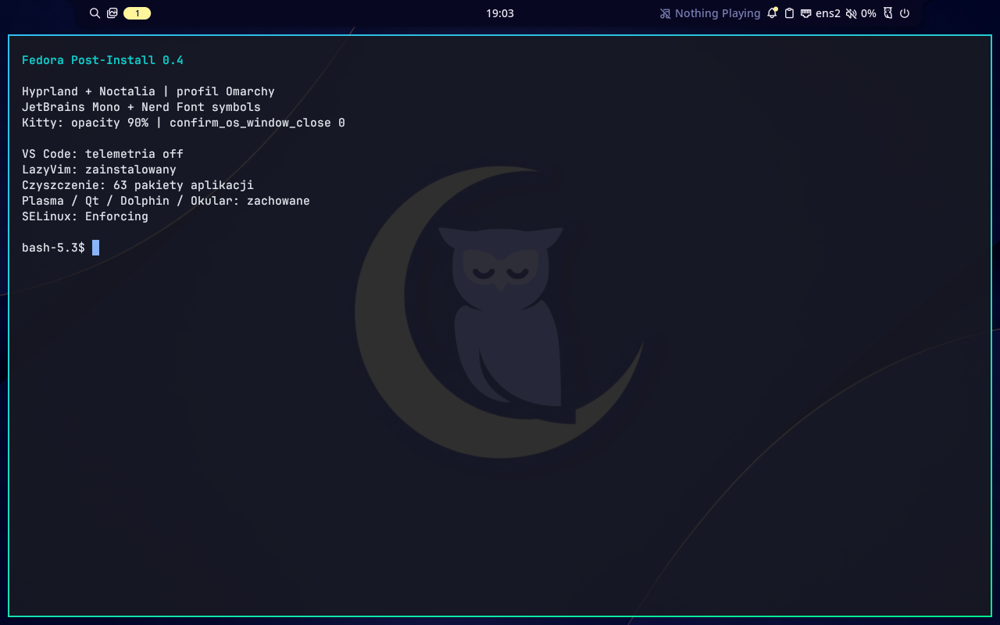

# Fedora Post-Install · Plasma / Noctalia / DMS

Modułowy instalator Bash dla **klasycznej Fedory 44 x86_64 z DNF5**, również Fedora KDE Desktop. Konfiguruje już zainstalowany system; nie jest dystrybucją. Fedora Atomic, inne wydania i ARM są blokowane. SELinux pozostaje Enforcing.



Projekt jest wydaniem testowym. Faktycznie wykonane testy, zrzuty GUI i ograniczenia opisuje [TESTING.md](TESTING.md). Do pracy z IDE zalecane jest 16 GB RAM i co najmniej 30 GB wolnego miejsca; potrzebne są internet, konto z sudo oraz niezależna kopia danych osobistych.

## Instalacja i TUI

```bash
git clone https://github.com/Jan-Bladek/fedora-postinstall.git
cd fedora-postinstall
bash install.sh


Do testów
bash install.sh --dry-run
```

Uruchamiaj jako zwykły użytkownik. Instalator pokazuje kolejno:

1. Wybór **Plasma**, **Hyprland + Noctalia** albo **Hyprland + DMS**.
2. Pytanie **Debloat Plasma: tak/nie** — cały zestaw z listy, bez wyboru pojedynczych aplikacji. Domyślnie nie.
3. Osobny wybór VS Code, RustRover, IntelliJ IDEA, WebStorm, CLion i Arduino IDE. Rust jest instalowany z RustRover, C/C++ z CLion, Node.js z WebStorm. Domyślnie zaznaczone jest VS Code.
4. Wybór LibreOffice Writer/Calc/Impress po polsku; wybór zachowuje go również przy debloat.
5. Jedno podsumowanie zgody na zmiany, źródła pakietów i klucze dostawców.
6. Ekran postępu z bieżącym etapem/aplikacją. Pełne wyjście poleceń trafia do logu.

TUI korzysta z whiptail, a gdy go brakuje — z Python curses. Nie wymaga pobrania skryptu interfejsu z internetu. TUI jest sprawdzane w terminalu 80×24; większe okno ułatwia czytanie. W podsumowaniu PgUp/PgDn przewija opis. W whiptail klawisz Tab przechodzi z opisu do przycisków; Enter zatwierdza. Esc anuluje wybór.

Po zatwierdzeniu nie trzeba wpisywać kolejnych T/YES przy DNF, Flatpak, źródłach i archiwach. Hasło sudo może być potrzebne raz; uprawnienia są odnawiane tylko podczas działania instalatora. Nie zmieniamy sudoers. Jeżeli nie ma terminala, wymagane jest jawne `--yes`.

Pasek pokazuje **ukończone moduły**, nie udaje procentu pobierania. Błąd kończy instalację, zamyka ekran postępu i wskazuje log. Ponowne uruchomienie sprawdza faktyczny stan, zamiast pomijać moduł na podstawie starego znacznika sukcesu.

```bash
bash install.sh --desktop noctalia
bash install.sh --desktop dms
bash install.sh --desktop plasma
# Tryb wsadowy po przejrzeniu planu:
bash install.sh --yes --desktop dms --cleanup-apps all --dev-profile full
# Własny wybór aplikacji do usunięcia:
bash install.sh --yes --desktop plasma --cleanup-apps "firefox libreoffice neochat"
# Zachowaj własny główny config Hyprland i otrzymaj propozycję zmian:
bash install.sh --desktop noctalia --keep-hypr-config
```

`--no-progress` pozostawia zwykły log w terminalu. `--dry-run` nie używa sudo, DNF, Flatpak ani sieci i działa również poza Fedorą; pokazuje wybrane moduły, nie rozwiązuje zależności na obcym systemie. `--dev-apps "code clion"` wybiera pojedyncze IDE (`none` = żadne). `--dev-profile code|full` wybiera zestaw IDE w trybie wsadowym (domyślnie `code`). Własny wybór modułów pozostaje dostępny przez `--modules`; zwykłe TUI nie ma checklisty modułów. Lista identyfikatorów czyszczenia dla CLI:

```bash
python3 scripts/cleanup-plan.py --catalog
# Dokładny plan pakietów na docelowej Fedorze (tylko odczyt RPM):
python3 scripts/cleanup-plan.py all
```

## Warianty pulpitu

| Wariant | Działanie |
|---|---|
| `noctalia` | Hyprland >=0.55 z Lua i Noctalia v5; wariant domyślny |
| `dms` | Hyprland i DankMaterialShell, obecnie nazwany Dux Shell; polecenie `dms` |
| `plasma` | Zachowanie zainstalowanej Plasma i instalacja wybranych aplikacji/narzędzi |

Wariant Plasma wymaga istniejących `plasma-desktop` i `plasma-workspace`. Nie konfiguruje Hyprland ani menedżera logowania. Aplikacje domyślne, font i ustawienia terminala mogą zostać zmienione zgodnie z wyborem modułów.

Warianty Hyprland **również zachowują Plasma**. Czyszczenie aplikacji nie jest usuwaniem środowiska. Sesję wybierasz na ekranie logowania; nie włączamy autologowania ani nie wymuszamy zmiany istniejącego menedżera logowania.

```bash
# Przełączenie zainstalowanej powłoki, następnie wylogowanie i nowa sesja:
bash install.sh --desktop dms --modules "hyprland dms"
bash install.sh --desktop noctalia --modules "hyprland noctalia"
```

Selektor `~/.config/fedora-postinstall/shell` steruje autostartem i skrótami. DMS nie jest włączany jako globalna usługa użytkownika, więc nie startuje w Plasma. Jeśli wcześniej sam włączyłeś `dms.service`, przejrzyj jego autostart przed użyciem selektora. DMS używa swojego Polkit; Noctalia uruchamia natywny `polkit-kde`.

## Moduły i źródła

| Moduł | Zakres |
|---|---|
| snapshots | Lista RPM/jednostek, kopia `/etc` i konfiguracji użytkownika; Snapper dla Btrfs |
| dependencies | Aktualizacja bazowych RPM, Git, curl, wget, archiwizacja, diagnostyka, schowek Wayland |
| hyprland | Hyprland, XWayland, portale Hyprland/GTK, PipeWire, WirePlumber, Polkit, NetworkManager, Bluetooth, Mesa |
| noctalia / dms | Jedna wybrana powłoka, bez Waybar, dunst i dodatkowego launchera |
| terminal | Kitty, Zsh + Oh My Zsh, prompt Starship w stylu Omarchy, Lua 5.4 z DNF, JetBrains Mono, symbole Nerd Fonts, konfiguracja fontów i terminala; btop z przezroczystym tłem |
| terminal-theme | Tekst i paleta ANSI Kitty zgodne z motywem DMS/Noctalia; odświeżanie otwartych okien |
| zsh | Sam Zsh + Oh My Zsh i przypięte wtyczki, z kopią i scaleniem `.zshrc` |
| clipboard | Historia schowka pod Win+Shift+V: cliphist + fzf w Kitty, Tab/strzałki/Enter/Esc; tylko Hyprland |
| lazyvim | Neovim, oficjalny starter LazyVim, lazy.nvim, ripgrep, fd, tree-sitter-cli i narzędzia kompilacji |
| development | Tylko wybrane IDE i ich SDK; `full` zawiera też CLion |
| libreoffice | Opcjonalny Writer, Calc i Impress z polskim pakietem językowym |
| hyprmod | GTK4/libadwaita HyprMod w narzędziu uv, przypięta rewizja; tylko Hyprland |
| files | Flea: przypięta kompilacja Rust i prywatne moduły QML, domyślny menedżer plików; bezpieczne usunięcie Nautilusa |
| omasnap | Przypięty build upstream Omasnap, testy, skróty, zarządzane aktualizacje/odinstalowanie; tylko Hyprland |
| vscode | Sam VS Code z oficjalnego repozytorium Microsoftu i wyłączoną telemetrią |
| browsers | Brave jako domyślny, LibreWolf jako dodatkowy |
| multimedia | OBS i rzeczywisty OpenH264; Vesktop i Steam z Flathub |
| utilities | Obsidian, LocalSend z Flathub; Tailscale RPM bez logowania do konta |
| defaults | Brave HTTP/HTTPS/HTML, VS Code dla tekstu, terminal Kitty |
| optimization | Diagnostyka; zachowanie zabezpieczeń i mechanizmów zarządzania energią Fedory |
| updates | Instalacja `~/.local/bin/fedora-update` i jego helperów |
| cleanup | Wybrane aplikacje z jawnej listy, bez usuwania Plasma/Qt/shared services |
| kde-removal | Oddzielny, ręcznie potwierdzany etap usuwania całej Plasma z działającej sesji Hyprland |

Jawne `--modules "dependencies hyprland noctalia terminal lazyvim updates"` określa dokładną listę i kolejność; pomija interaktywne wybory zestawu. Bazowa aktualizacja w `dependencies` chroni przed konfliktami starych pakietów z ISO z aktualnymi zależnościami. Po aktualizacji kernela zaplanuj restart.

Priorytetem są RPM Fedory i dostawców. Hyprland, gdy nie jest dostępny natywnie, korzysta z COPR `lionheartp/Hyprland`. DMS używa stabilnego RPM, a w razie potrzeby upstream COPR `duxlabs/dms` wraz z `duxlabs/dux-repo`. COPR to źródła społecznościowe. Nie dodajemy AUR, nie używamy `--allowerasing`, nie wykonujemy `curl | sh`.

Definicje repozytoriów są danymi: kontrolujemy HTTPS, dozwolone hosty i `gpgcheck=1`; nie wykonujemy pobranego pliku `.repo`. Klucze standardowych źródeł zatwierdzasz w podsumowaniu, a DNF weryfikuje podpisy. Nie jest to niezależna weryfikacja tożsamości klucza. Istniejący odmienny `.repo` blokuje automatyczne nadpisanie.

JetBrains RustRover, IntelliJ IDEA, WebStorm i CLion pochodzą z oficjalnego API i archiwów, z weryfikacją SHA256; Arduino z oficjalnego wydania AppImage i opublikowanego digest. Toolbox nie zarządza tymi kopiami. Licencje/trial aktywuje użytkownik. Aktualne i wcześniejsze wersje są w `~/.local/share/fedora-postinstall/apps/`; nie zastępujemy ich plikami z przypadkowych repozytoriów.

Desktop launchery JetBrains mają rzeczywisty SVG/PNG z archiwum, kanoniczne identyfikatory `jetbrains-*` i `StartupWMClass`. Naprawa działa także przy tej samej zainstalowanej wersji:

```bash
python3 scripts/vendor-apps.py repair
```

Własny zmieniony launcher jest zachowywany, z propozycją `.fedora-postinstall-new`. HyprMod jest instalowany zgodnie z [upstream](https://github.com/BlueManCZ/hyprmod), przez `uv tool install` z rewizji w `data/hyprmod-revision`, z natywnymi zależnościami GTK/PyGObject. `hyprmod --install` rejestruje launcher. `fedora-update` stosuje tylko rewizję dostarczoną z instalatorem. Usuwanie: `hyprmod --uninstall`, potem `uv tool uninstall hyprmod`. Instalacja w Fedorze wymaga jeszcze testu wykonawczego.

## Opcjonalne czyszczenie aplikacji

Lista jest w [data/cleanup.tsv](data/cleanup.tsv). Stary VSCodium można usunąć przez pozycję `vscodium`; nowa instalacja używa wyłącznie VS Code. Dane wcześniejszego edytora nie są kasowane. Obejmuje wskazane aplikacje PIM/KDE, gry, Firefox, LibreOffice, nwg-panel, Konsole i interfejsy zgłaszania problemów, a także pomocniki importu KMail, Spectacle, Dragon Player, Krfb, Gwenview, KAddressBook, KRDC i edytor menu KDE. Zestaw uwzględnia wspólne pakiety: np. KMail zawiera KTnef, Kleopatra dziennik GnuPG, a grantlee-editor wszystkie trzy edytory wyglądu kontaktów/nagłówków.

Usuwane są tylko zainstalowane pakiety z listy, w tym konkretne podpakiety danej aplikacji. Dolphin i dolphin-plugins są częścią debloat: przed ich usunięciem wymagane są działające Flea i zweryfikowane skojarzenie folderów `inode/directory`. Jeśli wybierzesz moduł `libreoffice`, czyszczenie `all` zachowa LibreOffice. Cały natywny LibreOffice obejmuje rodzinę `libreoffice-*`. Firefox i LibreOffice są również sprawdzane jako Flatpak użytkownika/systemu. Nie usuwamy danych aplikacji ani niewykorzystanych runtime’ów Flatpak.

Przed usunięciem: plan JSON i test `rpm -e --test`, pobranie dokładnych wersji RPM do odzyskiwania, ponowny test zależności. Po usunięciu: porównanie inwentarza dowodzące zachowania pozostałych pakietów oraz `dnf5 check`. **Brak dokładnego RPM w repo lub zależność zachowanego programu blokuje czyszczenie.** Standardowy przebieg najpierw aktualizuje pakiety; po częściowym błędzie napraw przyczynę i uruchom ponownie.

`uuctl` jest tylko ukrywany w launcherze, ponieważ należy do potrzebnego `uwsm`. Edytor menu `kmenuedit` również jest ukrywany, gdyż jest twardą zależnością zachowanej Plasma. Nie można bezpiecznie usunąć tego RPM i zachować kompletnych zależności Plasma. Nie usuwamy uwsm, Qt, KWin ani systemowych usług tylko po to, by usunąć aplikację. `kworker` to wątki jądra: nie wyłączamy ich. Zatrzymujemy/wyłączamy wyłącznie jednostki użytkownika należące do usuwanych aplikacji oraz ich wskazany daemon KDE Connect. Współdzielony Akonadi może pozostać potrzebny innym programom, jeśli pozostawisz część PIM przez CLI. Własne autostarty użytkownika nie są kasowane.

Przywrócenie RPM z TTY:

```bash
sudo dnf5 install ~/.local/state/fedora-postinstall/runs/PRZEBIEG/cleanup-rpms/*.rpm
```

Lista i dane aplikacji Flatpak pozostają oddzielne; ich ponowna instalacja wymaga właściwego zdalnego repozytorium. Kopia RPM nie jest pełnym snapshotem systemu.

## Hyprland, Kitty i font

Profil przenosi do Fedory układ Omarchy: gaps 5/10, border 2, brak zaokrągleń/cieni/blur, gradient aktywnego obramowania, animacje okien, dwindle i scratchpad. Używa Kitty, Brave, Flea, VS Code i wybranej powłoki; nie zależy od poleceń `omarchy-*` ani narzędzi Arch. Atrybucja: [Omarchy MIT](licenses/Omarchy-MIT.txt).

Moduł Hyprland stosuje żądany profil z kopią głównego pliku do katalogu przebiegu. Użyj `--keep-hypr-config`, aby zachować własną konfigurację i otrzymać propozycję zmian. Monitor domyślnie używa trybu i skali automatycznej. W DMS istniejące pliki monitorów/wyglądu z `~/.config/hypr/dms/*.lua` są wczytywane tylko przy wybranym DMS; jego zestaw skrótów nie zastępuje wybranych aplikacji.

| Skrót | Działanie |
|---|---|
| Super+Enter / Super+Space | Kitty / launcher powłoki |
| Super+W (także Q) / F / T | Zamknij / fullscreen / floating |
| Super+J / P | Zmiana podziału / pseudo |
| Super+strzałki / Shift+strzałki | Fokus / zamiana położenia okna |
| Super+1…0 / Shift+1…0 | Workspace / przeniesienie okna |
| Super+S / Alt+S | Scratchpad / przeniesienie do scratchpada |
| Super+Ctrl+S | Panel powłoki (wcześniej Super+S) |
| Super+Shift+Enter lub B | Brave |
| Super+Shift+F / N | Flea / VS Code |

JetBrains Mono jest instalowany z Fedory, z aliasami fontconfig i ustawieniem fontu Qt/DMS. Symbole Nerd Fonts są dodatkowym fontem z oficjalnego wydania, z digest SHA256; Kitty używa ich jako fallback dla ikon.

btop ma `theme_background = False`, więc używa tła terminala (w Kitty z jego przezroczystością). Pozostałe ustawienia btop są zachowywane; stara wartość i duplikaty tylko tego klucza są zastępowane.

Kitty: **Win+C / Win+V** kopiują zaznaczenie i wklejają schowek (mapowania `super+c` i `super+v`); Ctrl+C zachowuje przerywanie poleceń. `confirm_os_window_close 0`, `background_opacity 0.90`, JetBrains Mono. Inne własne ustawienia są zachowane; aktualizowany jest tylko oznaczony blok żądanych kluczy. VS Code: `TelemetryLevel=off` w `/etc/vscode/policy.json` i ustawienia użytkownika. JSONC jest scalany z zachowaniem wartości innych kluczy; oryginał z komentarzami znajduje się w kopii. Telemetria niezależnych rozszerzeń wymaga ich własnych ustawień; nie deklarujemy blokowania całego ruchu sieciowego.

## Flea — domyślny menedżer plików

Moduł `files` zastępuje Nautilusa przez [Flea](https://github.com/thisisgm/flea). Upstream oficjalnie wymaga Omarchy. To **adaptacja dla Fedory utrzymywana w tym projekcie**, a nie deklarowane przez autora wsparcie Fedory. Instalator buduje wersję `0.3.12` z przypiętej rewizji (`data/flea-release`), używa `cargo --locked --offline` i uruchamia testy Rust upstream. Nie używa pakietów Arch ani pacmana. Mała poprawka źródeł mapuje `/lib64` na `usr/lib64` wewnątrz sandboxu bubblewrap, zgodnie z układem Fedory; zachowuje wszystkie flagi izolacji. Nieznany układ upstream blokuje patchowanie, a digest poprawki jest częścią zapisu wersji payloadu.

GUI wymaga Quickshell >=0.3.1. Fedora 44 ma starszy pakiet, więc gdy nie ma odpowiedniego RPM, dodawany jest opisany wcześniej COPR `lionheartp/Hyprland`. Z Omarchy pobierane są tylko przypięte biblioteki komponentów `shell/Commons` i `shell/Ui`, umieszczane prywatnie obok Flea z licencją MIT. Nie instalujemy pakietu Omarchy, jego poleceń, panelu ani usług. Flea korzysta z własnej palety awaryjnej, gdy nie ma motywu Omarchy.

Przed przełączeniem aktywnego payloadu instalator ładuje prawdziwe QML w odizolowanej sesji offscreen i czeka na `flea ready` przez IPC. Dopiero po sukcesie ustawia `com.thisisgm.flea.desktop` dla `inode/directory`, zapisuje aktywację D-Bus `org.freedesktop.FileManager1` i usuwa RPM `nautilus` przez test zależności oraz pobranie dokładnej kopii do odzyskiwania. Nie usuwa zależności przez autoremove, rozszerzeń na ślepo ani Qt. Dolphin jest usuwany dopiero przez wybrany debloat. Wcześniejsza rejestracja FileManager1 jest kopiowana do katalogu przebiegu; już działający inny menedżer może zachować nazwę D-Bus do wylogowania.

Nie uruchamiamy `flea --default` ani `--picker`, które zakładają konfigurację Omarchy. Portale otwierania/zapisywania plików i udostępniania ekranu pozostają skonfigurowane jak dotychczas. Funkcje powiązane z paskiem/poleceniami Omarchy oraz podgląd diagramów/matematyki wymagający QuickJS-NG nie są objęte tą integracją. Bez istniejącego Cargo kompilator Rust jest doinstalowywany tylko na czas budowania Flea; po budowaniu (także po błędzie) usuwane są wyłącznie nowo dodane pakiety Rust/Cargo, po teście zależności. Wcześniejsze SDK i pozostałe zależności pozostają. Pozostałe zależności dostarcza DNF, w tym GVfs, UDisks, schowek, multimedia Qt i QtPdf. Nie instalujemy LibreOffice wyłącznie do opcjonalnych podglądów.

```bash
# Migracja istniejącej instalacji bez zmiany głównego configu Hyprland:
bash install.sh --yes --modules "files defaults updates"
~/.local/bin/flea --gui
~/.local/share/fedora-postinstall/scripts/flea-manager check
```

Preset Hyprland otwiera Flea przez `Super+Shift+F`. W istniejącym głównym Lua instalator dodaje tylko oznaczony loader na końcu i nadpisuje ten jeden skrót przez unbind/bind; pozostałe ustawienia zachowuje, a poprzedni plik kopiuje do katalogu przebiegu. Scentralizowane `fedora-update` sprawdza nowe tagi Flea i obsługuje wyłącznie sprawdzoną parę rewizji Flea/bibliotek QML; nowe źródła wymagają aktualizacji manifestu projektu. Aktualizacja nie wykonuje `git pull` konfiguracji. `flea-manager uninstall` odmawia usunięcia, dopóki Flea jest domyślnym handlerem katalogów; po wybraniu innego usuwa tylko zarządzane launchery i własną rejestrację D-Bus. Dane, ustawienia i starsze payloady pozostają.

## Omasnap: screenshoty i edycja

Instalujemy [Omasnap upstream](https://github.com/omacom/omasnap), bez Omarchy i bez uruchamiania jego `install-omarchy`. Wersja `1.24.0` i pełna rewizja są przypięte w `data/omasnap-release`. Zależności Fedora RPM: GCC/C++, Git, CMake, Ninja, pkgconf, Qt6 >=6.8 (base-devel/Wayland), layer-shell-qt-devel, wayland-devel/protocols-devel, libdeflate-devel, wl-clipboard, xdg-utils oraz Tesseract z angielskim modelem. Budowanie ma dwa równoległe zadania i wykonuje testy upstream przez CTest przed przełączeniem launchera.

Lokalna poprawka `data/omasnap-pin-cleanup-test.patch` dotyczy wyłącznie testu: czeka do 5 sekund na usunięcie plików przypiętego obrazu przez zadania w tle, zamiast sprawdzać ich brak natychmiast po zamknięciu edytora. Zachowuje wszystkie kontrole obrazu źródłowego, historii operacji i usunięcia plików. Kod aplikacji nie jest zmieniany. Skrót poprawki jest częścią identyfikatora kompilacji, więc jej zmiana wymusza ponowne budowanie. Pełne logi CTest pozostają w `~/.local/share/fedora-postinstall/apps/omasnap/test-logs/` również po niepowodzeniu; poprzednia działająca wersja jest zachowywana.

- **Print** otwiera inteligentny wybór obszaru/okna/monitora; wynik jest kopiowany i domyślnie zapisywany w `~/Pictures/Screenshots`.
- **Super+Shift+S** otwiera wybór obszaru z natychmiastową edycją (`--capture-region --editor overlay`).
- Edytor upstream zapewnia strzałki, tekst i redakcję: pikselizację lub pełne zakrycie. **Wersja 1.24.0 nie ma klasycznego blur**; nie deklarujemy tej funkcji ani nie dodajemy własnego forka. Copy/Save zapisują spłaszczony obraz; schowek używa wl-copy/wl-paste.

Te dwa skróty mają pierwszeństwo nad dotychczasowym screenshotem DMS/Noctalia lub własnymi przypisaniami. Osobny plik `~/.config/hypr/fedora-postinstall-omasnap.lua` jest wczytywany na końcu głównego Lua; wywołuje `hl.unbind` przed nowym `hl.bind`. Nie przepisujemy pozostałych skrótów ani profili powłok. Przy aktywnej sesji wcześniejsze kolizje trafiają do logu JSON, wykonywany jest reload i kontrola błędów. Kopia głównej konfiguracji: `hyprland-before-omasnap.lua` w katalogu przebiegu. Konfiguracja użytkownika `~/.config/omasnap/omasnap.conf` pozostaje nietknięta. Nie wykluczamy warstwy Omasnap z screen sharingu — upstream ostrzega, że psuje to przechwytywanie przewijanej zawartości.

```bash
# Dodanie do istniejącej konfiguracji Hyprland bez stosowania całego presetu:
bash install.sh --yes --desktop noctalia --modules "files omasnap defaults updates"
# W działającej sesji:
validate-omasnap
# Jawny test przechwycenia monitora — zastępuje obraz w schowku:
validate-omasnap --capture-smoke
```

Kontrola CLI/parsera i testy offscreen nie zastępują interaktywnego testu zaznaczania, strzałek, tekstu, redakcji i Copy/Save na danym GPU. Obsługa Plasma nie jest deklarowana — preset Plasma nie instaluje Omasnap. Integracja powłok dotyczy wspólnych skrótów Hyprlanda; przyciski screenshotów wewnątrz DMS/Noctalia pozostają zarządzane przez te projekty. Powiadomienia Omarchy są opcjonalne w upstream; nie instalujemy ich zamiennika.

Zarządzanie buildem:

```bash
~/.local/share/fedora-postinstall/scripts/omasnap-manager check
~/.local/share/fedora-postinstall/scripts/omasnap-manager update
~/.local/share/fedora-postinstall/scripts/omasnap-manager uninstall
```

Updater sprawdza dostępne tagi upstream i instaluje/przebudowuje tylko rewizję zatwierdzoną w instalatorze, jeśli brakuje jej lub przestał działać CLI po zmianie bibliotek Qt. Nowy tag wymaga aktualizacji sprawdzonego manifestu projektu; nie kompilujemy dowolnego Git HEAD ani nie nadpisujemy konfiguracji. Nieudany build zachowuje działający payload. Odinstalowanie usuwa wyłącznie zarządzane launchery i link current; stare payloady, kopie oraz screenshoty zostają. Blok Lua nie aktywuje skrótów, jeśli zarządzany plik wykonywalny nie istnieje; po odinstalowaniu przeładuj Hyprland, aby wrócić do wcześniejszych przypisań.

## LazyVim

Instalowany jest oficjalny [starter LazyVim](https://www.lazyvim.org/installation), przypięty do rewizji z `data/lazyvim-starter-revision`. Wtyczki instaluje oficjalny lazy.nvim, zapisując `lazy-lock.json`. Istniejące środowisko Neovim jest przenoszone do katalogów `.pre-fedora-postinstall-*`, zgodnie z informacją w podsumowaniu. Nie kasujemy tych kopii. Po instalacji wykonaj `:LazyHealth`, aby sprawdzić opcjonalne providery/language servers. LazyGit jest opcjonalny i nie wymaga dodawania osobnego COPR w tym projekcie.

## Scentralizowane aktualizacje

Dodaj `~/.local/bin` do PATH. Jedno polecenie:

```bash
fedora-update
# Podgląd bez sudo i instalowania aktualizacji:
fedora-update --check
# Bez pytania o rozpoczęcie:
fedora-update --yes
```

Obejmuje DNF i aktywne COPR/repozytoria dostawców, Flatpak user/system, zarządzane archiwa JetBrains i Arduino AppImage, Rustup jeśli używany, zarządzany LazyVim, symbole Nerd Fonts i zainstalowane rozszerzenia VS Code. Noctalia i DMS aktualizują się przez RPM. Osobne etapy Omasnap i Flea sprawdzają tagi oraz obsługują przypięte, sprawdzone rewizje bez modyfikacji konfiguracji. Flea sprawdza także ładowanie QML po aktualizacji bibliotek. Niezainstalowane aplikacje producentów nie są pobierane.

LazyVim używa `Lazy check/update`, bez `git pull` konfiguracji; kopia lockfile pozwala na próbę `Lazy restore` po błędzie. Nie obiecujemy zgodności każdej zewnętrznej wtyczki. Narzędzie nie aktualizuje arbitralnych plików w `/usr/local/bin`, nie dotyka cudzych checkoutów Git, środowisk pip ani projektów npm. Aktualizacje RPM pokrywają systemowe Python/C++/Rust. Logi: `~/.local/state/fedora-postinstall/updates/`.

Przed pierwszą aktualizacją tworzony jest punkt konfiguracji; jeśli Btrfs ma już konfigurację Snapper `root`, także migawka systemu. Błąd skonfigurowanej migawki przerywa aktualizację. Bez niej kopia plików nadal powstaje, ale nie zapewnia cofania pakietów systemowych. Po sukcesie, błędzie i przerwaniu aktualizator zapisuje `report.json`: wynik etapów, zmienione wersje RPM, ścieżki zmienionych plików, ID kopii/migawki i zalecenie restartu z `dnf5 needs-restarting`. Brak tego polecenia daje wynik „nie ustalono”. Pierwszy nieudany etap zatrzymuje kolejne; nie uruchamiamy automatycznego rollbacku.

`--check` sprawdza RPM/COPR, Flatpak user/system (repozytoria z zainstalowanymi referencjami) i Rustup. Jeżeli serwer lub systemowe repozytorium OCI odmawia dostępu bez autoryzacji, podgląd zgłasza błąd danego kanału zamiast deklarować jego aktualność. Odświeża metadane repozytoriów, ale nie tworzy punktu kopii i nie uruchamia konfiguracji Neovim. Kod `100` z DNF oznacza dostępne aktualizacje, a nie błąd. Pozostałe kanały są jawnie oznaczone jako niesprawdzone; brak aktualizacji RPM nie oznacza aktualności wszystkich źródeł.

## Kopie, usuwanie Plasma i odzyskiwanie

Każdy przebieg ma log i kopie w `~/.local/state/fedora-postinstall/runs/`. Na Btrfs moduł snapshots używa istniejącej konfiguracji Snapper lub — po zgodzie w podsumowaniu — tworzy konfigurację root. Nie dodaje bootloadera ani nie zakłada, że snapshot można uruchomić. Osobne subwolumeny, szczególnie `/home`, mogą nie być objęte snapshotem. Kopie konfiguracji nie zastępują backupu danych osobistych. Nie ma automatycznego przywracania całego systemu.

Moduł `updates` instaluje również `fedora-restore`. Każda nowa instalacja i aktualizacja zapisuje stan plików przed i po wykonaniu. Dostępne grupy: `hyprland`, `kitty`, `zsh`, `defaults`, `desktop`, `services`, `applications`, `lazyvim`, `packages`.

```bash
fedora-restore list
# Sam plan, bez zmieniania plików:
fedora-restore ID_KOPII --components kitty,defaults
# Wykonanie planu:
fedora-restore ID_KOPII --components kitty,defaults --apply
# Import starszego archiwum user-config.tar.gz z runs/ID_PRZEBIEGU:
fedora-restore import ID_PRZEBIEGU
```

Przywracanie odmawia nadpisania plików zmienionych po zapisaniu końcowego stanu. `--force` jawnie dopuszcza nadpisanie takich edycji; `--yes` jedynie pomija pytanie. Stare importowane kopie nie zawierają stanu końcowego, więc różniące się pliki wymagają `--force`. Przed przywracaniem powstaje kolejny punkt pozwalający cofnąć tę operację. Program weryfikuje sumy kopii, nie przechodzi przez podmienione dowiązania katalogów i nie usuwa rekurencyjnie katalogów z dodatkowymi plikami użytkownika. Po zmianie konfiguracji uruchom ponownie aplikację lub sesję.

`applications` przywraca zarządzane launchery i dowiązania `current` do zachowanych wersji aplikacji; payloady muszą nadal istnieć. `packages` instaluje wyłącznie zachowane `cleanup-rpms`/`plasma-rpms` z danego przebiegu, po kontroli sum i zaufanych podpisów RPM. Nie usuwa później doinstalowanych pakietów. `zsh` obejmuje konfigurację, nie zmienia powłoki logowania. Przywrócenie konfiguracji LazyVim nie cofa automatycznie pobranych wtyczek — użyj potem `:Lazy restore`. Narzędzie nie cofa wersji Flatpak, Rustup, rozszerzeń VS Code ani całego `/etc`. Migawka Snappera jest wskazywana do osobnego przywracania zgodnego z układem subwolumenów i sposobem startowania systemu.

Całkowite usuwanie środowiska Plasma pozostaje **oddzielnym etapem**, dopiero po zalogowaniu do Hyprland i ręcznych testach:

```bash
bash scripts/validate-session --check-only
bash scripts/plan-plasma-removal
bash install.sh --modules kde-removal
```

To celowy wyjątek od automatycznej zgody: usuwanie sesji nadal wymaga osobnego ręcznego potwierdzenia. Plan może być blokowany przez zależności menedżerów logowania od KWin. Sam pakiet SDDM nie gwarantuje niezależnego greeter’a. Nie wymuszaj `--nodeps`, `--allowerasing` ani `dnf group remove`.

TTY: Ctrl+Alt+F3. Poprzedni główny config Hyprland: `hyprland-before-requested-preset.lua` w katalogu przebiegu. Oryginały Kitty, VS Code i archiwum `.config` również tam. Przywrócenie usuniętej sesji używa `plasma-rpms/*.rpm` z właściwego przebiegu i ponownego uruchomienia działającego menedżera logowania.

## Diagnostyka i ograniczenia

```bash
hyprctl configerrors
journalctl --user -b
systemctl --user status pipewire wireplumber xdg-desktop-portal-hyprland
sudo dnf5 check
```

Po błędzie przejrzyj końcówkę `install.log`. Nie ukrywamy nieudanego pobrania, testu zależności ani brakującego pakietu przez pomijanie błędów. `fedora-update` nie uruchamia się równolegle z instalatorem.

W lokalnej VM TCG/VirGL wykryto problemy z wybudzaniem grafiki oraz startupem realtime. DMS GUI testowano z tymczasowym `HYPRLAND_NO_RT=1`; instalator tego nie wymusza na zwykłym sprzęcie. Obejście EGL jest ograniczone do Hyprland 0.57.0 w VM. Fizyczne GPU, NVENC/VAAPI, mikrofon, hotplug/HiDPI i zarządzanie energią nadal wymagają testów. Tailscale startuje bez automatycznego logowania. LocalSend może wymagać reguły firewalla dla zaufanej sieci; nie otwieramy portów globalnie.

OBS korzysta z PipeWire i portalu z interaktywną zgodą. Atrapa `noopenh264` jest zastępowana prawdziwym OpenH264 z repozytorium Fedora/Cisco; faktyczne kodowanie klatki weryfikuje działanie. Pakiety wymagające atrapy po nazwie blokują wymianę. Nie nadpisujemy profili OBS ani nie obiecujemy akceleracji sprzętowej.

## Testy i źródła

```bash
# Bash, ShellCheck, Python 3 i Lua 5.4:
bash tests/check.sh
```

Testy integracyjne `tests/experience.sh`, `tests/obs-codec.sh` i `tests/vm/integration.py` są przeznaczone wyłącznie do jednorazowych kontenerów/VM. Nie uruchamiaj ich na głównym systemie. Interaktywny `tests/vm/portal-smoke.py` wymaga zgody na przechwycenie testowego pulpitu; przed publikacją sprawdź obraz.

Oficjalne odniesienia: [VS Code RPM](https://code.visualstudio.com/docs/setup/linux), [polityki i telemetria](https://code.visualstudio.com/docs/enterprise/policies), [LazyVim](https://www.lazyvim.org/installation), [DMS](https://duxlabs.dev/docs/dms/installation), [Hyprland](https://wiki.hypr.land/), [OpenH264 Fedora](https://fedoraproject.org/wiki/OpenH264), [JetBrains Mono](https://www.jetbrains.com/lp/mono/).

## Zmiany konfiguracji po v0.6

`EDITOR=nano` i `VISUAL=nano`; Nano jest instalowane przez `terminal`. VS Code pozostaje graficznym skojarzeniem plików tekstowych. LazyVim uruchamiasz przez `nvim`; dodane animacje Snacks obejmują przewijanie i zakresy wcięć. Ich wyłączenie: `vim.g.snacks_animate = false`. Istniejący zmieniony plik wtyczki nie jest nadpisywany.

Kolory obramowań DMS są ładowane przez jawne `require("dms.colors")` i analogiczne moduły układu/wyjść. To pozwala Hyprlandowi śledzić generowane pliki i DMS rozpoznać dołączenia. Moduł `dms` przygotowuje brakujące pliki i migruje wyłącznie znany stary blok instalatora, z kopią oraz weryfikacją Hyprland. Własne inne importy wymagają ręcznego scalenia. W ustawieniach DMS pozostaw włączone generowanie motywu Hyprland z tapety. Zmiany stosuje następne logowanie lub przeładowanie Hyprlanda.

Przykładowa aktualizacja konfiguracji i dodanie HyprMod (po przejrzeniu planu):

```bash
bash install.sh --dry-run --desktop dms --modules "terminal dms lazyvim hyprmod updates"
bash install.sh --yes --desktop dms --modules "terminal dms lazyvim hyprmod updates"
# Tylko wybrane IDE i ich SDK:
bash install.sh --yes --modules development --dev-apps "code clion"
# Flea i debloat, z zachowaniem LibreOffice:
bash install.sh --yes --modules "files cleanup libreoffice" --cleanup-apps all
```

Kompilatory C/C++ potrzebne do budowania Flea, Omasnap, wtyczek Neovim i HyprMod są zależnościami tych modułów także bez CLion. Wybór IDE nie usuwa wcześniej zainstalowanych SDK.

## Zsh, Lua i historia schowka

`dependencies` i `terminal` instalują natywny pakiet `lua` przez DNF; w Fedorze 44 dostarcza on interpreter **Lua 5.4.8**. Nie dodajemy drugiego interpretera pod ręcznie utworzonym aliasem `lua5.4`.

Moduł `terminal` instaluje teraz **Zsh jako powłokę logowania i powłokę Kitty**. Instalator nadal działa w Bash. Oh My Zsh oraz wtyczki [zsh-autosuggestions](https://github.com/zsh-users/zsh-autosuggestions), [zsh-syntax-highlighting](https://github.com/zsh-users/zsh-syntax-highlighting) i [zsh-interactive-cd](https://github.com/johannjhang/zsh-interactive-cd) są przypięte do rewizji z `data/zsh-sources.json`. Oh My Zsh ładuje też swoje wtyczki `git` i `fzf`. Żaden pobrany skrypt instalacyjny nie jest uruchamiany. Automatyczny updater Oh My Zsh jest wyłączony; `fedora-update` stosuje sprawdzone rewizje dostarczone wraz z projektem.

Wygląd zapewnia Starship: ten sam format ścieżki, statusu Git i cyjanowego znaku `❯` co w Omarchy. Natywne archiwum Starship jest weryfikowane przez SHA256; nie wymaga kompilatora Rust. Konfiguracja promptu pochodzi z Omarchy i jest objęta [licencją MIT](licenses/Omarchy-MIT.txt). `.zshrc` jest scalane w oznaczonym bloku i kopiowane przed zmianą; własny plik promptu jest zachowywany. `EDITOR`, `VISUAL` i `SUDO_EDITOR` pozostają ustawione na Nano. Zmiana powłoki obowiązuje w nowym terminalu; powrót do Bash: `chsh -s /bin/bash` i zmiana ustawienia `shell` w Kitty.

**Win+Shift+V** otwiera listę historii z wyszukiwaniem. **Tab / Shift+Tab / ↑ / ↓** przesuwają zaznaczenie; **Enter** przywraca wybrany wpis do schowka; **Esc** zamyka bez zmiany. Następnie wklejasz Win+V w Kitty. Obsługiwane są tekst i obrazy, z zachowaniem oryginalnych bajtów. Wpisy zapisuje `cliphist` lokalnie na dysku; wyczyszczenie: `clipboard-history clear`. Usługa `fedora-clipboard.service` startuje tylko z sesji Hyprland. Nie jest włączana globalnie w Plasma ani podczas SSH.

Aktualizacja istniejącej instalacji:

```bash
bash install.sh --dry-run --desktop noctalia --modules "terminal clipboard updates"
bash install.sh --yes --desktop noctalia --modules "terminal clipboard updates"
# Dla DMS użyj --desktop dms. Sam Zsh: --modules zsh.
```

Moduł `clipboard` dopisuje tylko własny blok do konfiguracji Hyprland, z kopią i sprawdzeniem parserem. Win+V w Kitty pozostaje skrótem wklejania.

## Kolory terminala z motywu systemu

Kitty korzysta z palety wybranej powłoki: w Noctalii włączany jest oficjalny szablon `kitty`, a w DMS — generowanie Matugen dla Kitty. Gdy system używa kolorów tapety, zmiana tapety zmienia też zwykły tekst, 16 kolorów ANSI (w tym prompt Zsh), kursor, zaznaczenie i tło terminala. Nie trzeba zamykać otwartych okien.

Moduł `terminal` konfiguruje to automatycznie. Osobny `terminal-theme` pozwala zaktualizować istniejącą instalację bez ponownego instalowania Zsh:

```bash
bash install.sh --dry-run --desktop dms --modules terminal-theme
bash install.sh --yes --desktop dms --modules terminal-theme
# Dla Noctalii zamień dms na noctalia.
```

Usługa użytkownika `fedora-kitty-theme.path` obserwuje plik palety wybranej powłoki i przeładowuje wyłącznie procesy Kitty bieżącego użytkownika przez SIGUSR1. Nie wymaga otwierania zdalnego sterowania terminalem i nie odpytuje plików w pętli. Pozostałe ustawienia i szablony są zachowywane. Noctalia wymaga pakietu `python3-tomlkit` z DNF do bezpiecznego scalania TOML z komentarzami. Zapisane przez Kitty pliki `dark-theme.auto.conf`, `light-theme.auto.conf` i `no-preference-theme.auto.conf` są przenoszone do kopii w katalogu przebiegu, ponieważ mogłyby zasłaniać kolory systemowe.

Programy, które samodzielnie ustawiają kolory RGB, nadal używają własnego motywu. Wariant Plasma zachowuje dotychczasową konfigurację kolorów. Wybór źródła palety (tapeta albo motyw stały) pozostaje w ustawieniach DMS/Noctalii.

### DNF instaluje Node.js, ale starszy instalator zgłasza brak `nodejs`

Fedora 44 może dostarczać `nodejs` i `npm` przez pakiety `nodejs22` oraz `nodejs22-npm`. Instalator sprawdza teraz także RPM `Provides`, zgodnie ze sposobem rozwiązywania nazw przez DNF, zarówno przed instalacją, jak i w końcowej weryfikacji. Dodatkowo sprawdza działanie `node --version` i `npm --version`.

Po błędzie `Requested RPM was not installed: nodejs` zaktualizuj projekt (`git pull`) i ponów instalację z tymi samymi opcjami. Nie trzeba usuwać ani ponownie instalować działającego Node.js.

### Powiadomienia FUMonitor o jednostkach w stanie failed

Start DMS/Noctalii przekazuje teraz synchronicznie środowisko Hyprland/Wayland do D-Bus i menedżera systemd użytkownika, zanim powłoka uruchomi aplikacje autostartu. Obejmuje to `XDG_SESSION_TYPE=wayland`, `XDG_SESSION_DESKTOP=Hyprland` i aktualny `DISPLAY`, jeśli jest dostępny. Po aktualizacji konfiguracji uruchom ponownie sesję graficzną.

Debloat zatrzymuje także należące do usuwanych aplikacji timery, gniazda i jednostki path, a nie tylko usługi. Po usunięciu RPM czyści stan błędu wyłącznie wskazanych usuniętych jednostek. Nie maskuje KSplash/imsettings, nie wyłącza monitora błędów i nie wykonuje globalnego `reset-failed`.

Samo powiadomienie nie podaje przyczyny. Aby zebrać szczegóły dla zgłoszonych jednostek:

```bash
journalctl --user -b --no-pager -n 150 | rg -i 'drkonqi|imsettings|ksplash'
systemctl --user --failed --no-pager
```

Jeśli błąd pozostaje po aktualizacji i nowym logowaniu, zachowaj te logi przed czyszczeniem stanu jednostek. Stan failed może opisywać wcześniejsze, zakończone uruchomienie.

### KSplash: `WaitForName: Service was not registered within timeout`

`plasma_waitforname org.kde.KSplash` czeka na ekran powitalny Plasma, którego nie ma w sesji Hyprland. Moduł `session-services` dodaje lokalną aktywację D-Bus z jednostką `fedora-ksplash-activation.service`. Jej `ExecCondition` pomija uruchomienie w Hyprlandzie. Przy środowisku KDE pozostaje oryginalny helper Fedory — pliki RPM i działanie ekranu powitalnego Plasma nie są zastępowane.

```bash
git pull
bash install.sh --yes --desktop dms --modules session-services
# Dla profilu Noctalia: --desktop noctalia.
```

Poprawka działa od razu w uruchomionej sesji Hyprland: przeładowuje konfigurację D-Bus/systemd, zapisuje logi starych błędów KSplash w prywatnym katalogu przebiegu i czyści tylko ich stan failed. Pozostałe błędy usług pozostają. Własne zmienione pliki aktywacji są zachowywane z propozycją `.fedora-postinstall-new`; w takim przypadku trzeba przejrzeć propozycję. Nowa instalacja Hyprland konfiguruje tę integrację automatycznie.

Guard dotyczy zweryfikowanego wpisu Fedory używającego `/usr/bin/plasma_waitforname org.kde.KSplash`. Odmienny mechanizm upstream jest pozostawiany do przeglądu. Samo wywołanie nieobecnego KSplash przez aplikację nadal zwraca błąd D-Bus, lecz nie uruchamia minutowego oczekiwania ani jednostki kończącej się awarią. Nie jest tworzony fikcyjny serwer KSplash.
