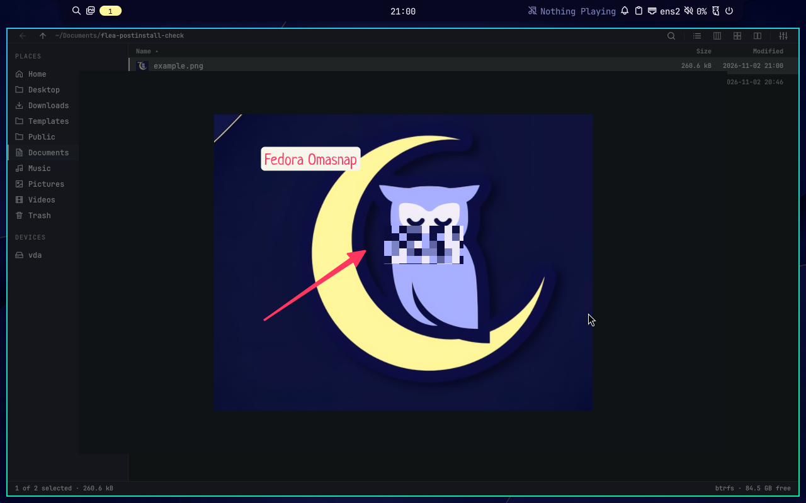
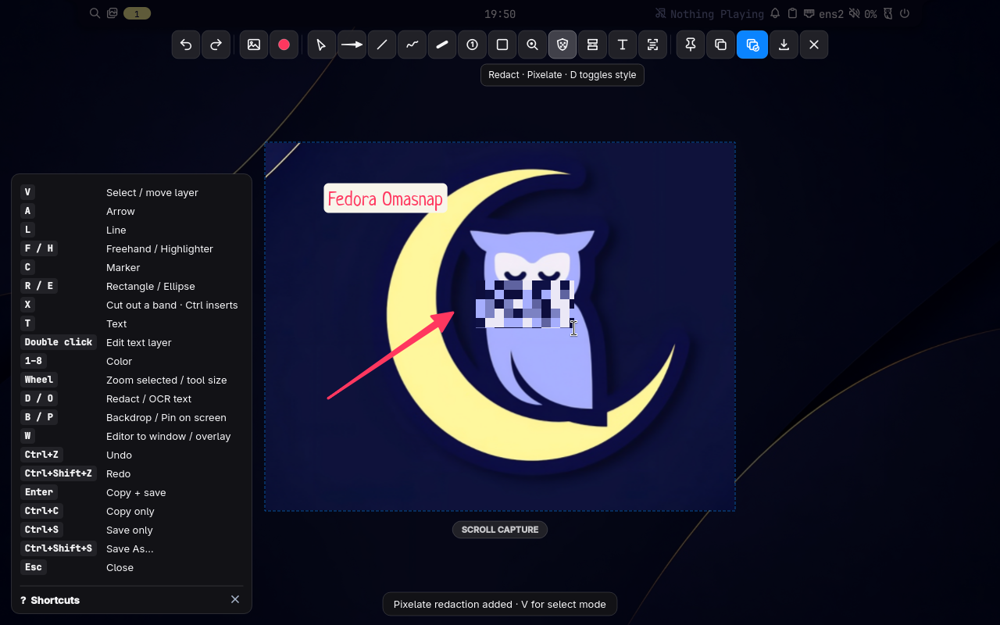
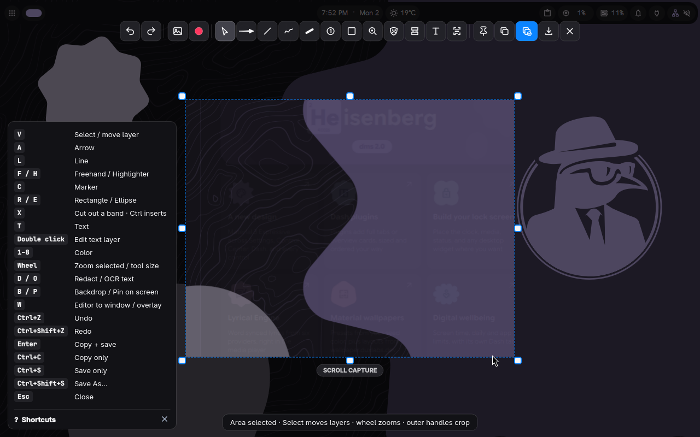
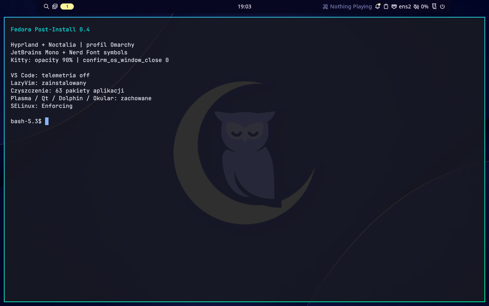
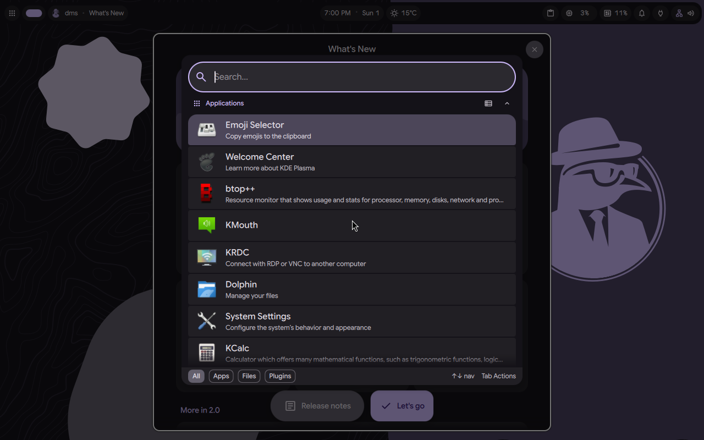
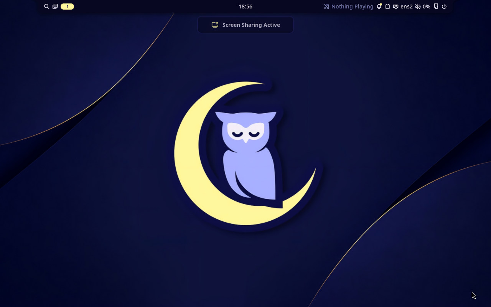
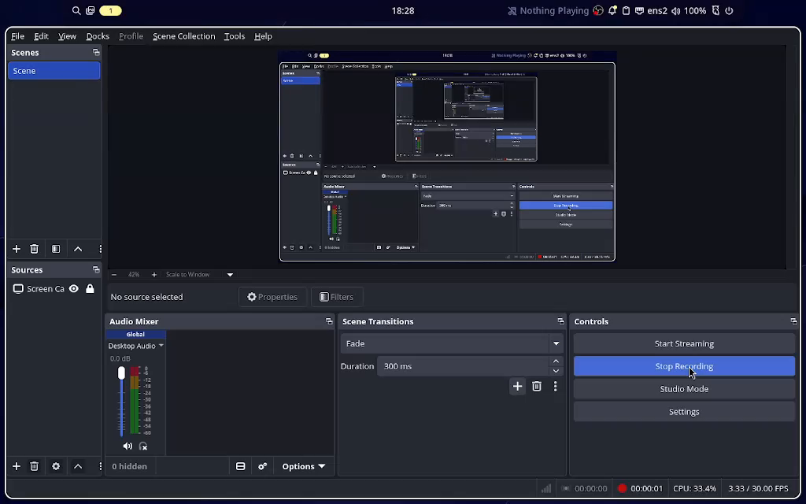
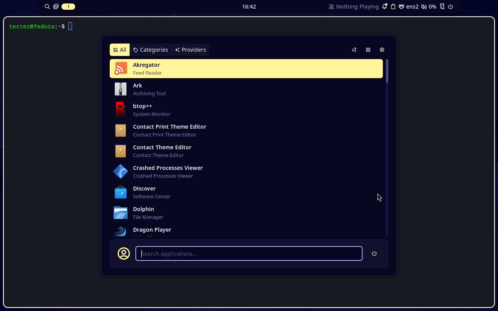

# Validation record — updated 2026-11-02

**Full Fedora KDE 44 CLI installation, repeat and reboot passed** in
[the follow-up KVM run](https://github.com/Jan-Bladek/fedora-postinstall/actions/runs/41304027246).
The separate local VM demonstrated Noctalia/Kitty GUI, lock/unlock, portal frames
and a short OBS recording. Graphical suspend/resume failed in its TCG/VirGL setup
on both tested kernels. Positive Plasma removal is untested.

## Unreleased — installer options and DMS includes

Changes: Kitty Super+C/V, optional LibreOffice with debloat retention, individual
IDE selection including CLion and conditional SDKs, nano as EDITOR/VISUAL,
Snacks animations, pinned HyprMod, Dolphin removal guarded by Flea health/default
checks, tracked DMS Lua imports and migration, temporary Flea Rust compiler.

Local Bash syntax and ShellCheck pass. Hyprland **0.56.2** accepted the new main
configuration with all six DMS modules in an isolated `--verify-config` run
(`config ok`, exit 0); no host session configuration was changed.

**51 of 52 local regressions pass**; `test_session` cannot bind its temporary
AF_UNIX socket in this execution sandbox (`PermissionError: Operation not
permitted`). This is an environment restriction, not a passing session check.
The other tests include native whiptail interaction, IDE-specific SDK selection,
CLion-only downloads, office retention for both RPM and Flatpak cleanup, DMS
migration preservation/idempotence, and temporary compiler cleanup on successful
build, failed build and refused dependency checks.

This revision has **not** been tested in the Fedora VM or with a live DMS wallpaper
change. HyprMod installation, the actual transient Rust RPM transaction and visual
LazyVim animations still need Fedora runtime validation. The previous v0.6 VM/CI
results below apply to the previous code, not these changes. Network/DNS access
from the local command runner is restricted in this session.

## v0.6.0 — Flea replaces Nautilus

The final runtime commit `793b480` passed [all five CI jobs in run 41514377954](https://github.com/Jan-Bladek/fedora-postinstall/actions/runs/41514377954). Documentation and evidence were added afterward without changing runtime code.

- Local Bash syntax/ShellCheck and **46 regressions** passed. Added coverage includes
  quoted paths and folder arguments, generic `xdg-mime` readback with spaces in HOME,
  preserving custom launcher fields during repair, retaining payload/defaults on fetch
  failure, preventing Nautilus removal after a failed Flea install, preserving the
  sandbox boundary while changing the Fedora library path, and keeping the optional
  read-only CI API token off download requests and redirect headers.
- [Native Fedora run 41513684114](https://github.com/Jan-Bladek/fedora-postinstall/actions/runs/41513684114)
  passed all five jobs, including the expanded experience fixture: seed Nautilus,
  compile Flea, run its Rust tests, load the real QML through offscreen IPC, migrate
  the directory handler, remove only Nautilus with exact recovery RPMs, repeat the
  installation, and run centralized updates. DMS, Omasnap and native compiler jobs
  also passed. Container namespaces can restrict sandbox tests; the real VM check
  below is separate evidence for those paths.

Flea v0.3.12 is pinned to `f21789e56cc4b0877caa3156fff7bce52a8dd9c2`.
Only Omarchy's Commons/Ui component libraries are used from pinned revision
`a69b19f64efa78143155f2f46c85e7e05a09e05f`. No Omarchy shell, package manager,
services or global library path was installed. `cargo build --release --locked
--offline` builds the installed binary; `cargo test --locked --offline` runs the
upstream Rust suite without duplicating the expensive release LTO for the test
harness. This is a Fedora adaptation, not upstream's supported installation route.

The existing Fedora 44 KVM/VirGL guest completed the file-manager migration and a
repeat. Flea became `com.thisisgm.flea.desktop` for `inode/directory`, Nautilus was
removed after its exact RPM was downloaded, and all other installed RPMs were
retained by the erase-inventory check. The user FileManager1 registration activated
Flea for an actual D-Bus `ShowItems` call: its window opened the requested directory
and selected the fixture file. Physical Super+Shift+F opened Flea after closing that
window. Hyprland parser/runtime checks and the two Omasnap bindings still passed.

Fedora-specific corrections verified during this work:

- Fedora packages `bsdtar` separately from `libarchive`; the missing tool initially
  stopped the upstream suite before installing a payload or removing Nautilus.
- A valid quoted absolute desktop Exec was accepted by GLib but rejected by generic
  `xdg-mime`. The launcher now uses `/usr/bin/env` followed by the quoted absolute
  program path. Both handlers read back Flea; the desktop file also passed
  `desktop-file-validate`. Only the known old Exec is repaired on an existing
  payload, preserving unrelated custom fields.
- Upstream maps `/lib64` to `usr/lib`, matching Arch. On Fedora this prevented
  sandboxed executables from finding their ELF loader. The reviewed adaptation maps
  it to `usr/lib64`, keeping unshare/read-only mounts and resource caps intact.
  The patch refuses an unknown source shape; its digest is in the payload receipt.
- Two real sandbox-limit tests used `/etc/hostname`, which this Fedora guest lacks.
  Their input is now `/etc/passwd`, another existing regular file already under the
  read-only `/etc` mount. Their assertions are unchanged. An independent production-
  shaped bubblewrap/prlimit invocation returned both address-space limits as
  `2147483648` bytes. No hostname file or security setting was created/changed.
- A shared CI address hit GitHub's anonymous metadata rate limit while fetching
  Nerd Fonts. The experience job uses its temporary read-only token for API requests
  only; unredirected headers prevent it from following asset redirects.
- Installing Nautilus alongside KDE Connect adds `kde-connect-nautilus`. The exact
  plugin was added to KDE Connect's cleanup group; [cleanup run 41511310576](https://github.com/Jan-Bladek/fedora-postinstall/actions/runs/41511310576)
  passed after that correction with the retained Plasma/Qt/app inventory unchanged.

Flea's Omarchy-only default/picker commands were not invoked. Existing GTK/Hyprland
portal routing stays in place. Omarchy shelf integration and QuickJS-NG-dependent
math/diagram previews are outside this adaptation. Remote devices, ISO flashing,
physical GPUs and Plasma's graphical Flea session have not been exercised here.
This is an upgrade/migration of the existing guest, not a complete fresh-ISO v0.6
installation. The final patched KVM run passed **2954 Rust tests, 0 failed, 2 ignored**, with no
sandbox-unavailable SKIP messages. The two ignored cases are upstream's manual
local-copy benchmark and 200k-entry tag timing test. The real decoder/archive
sandbox limits were exercised, not skipped. An actual PNG Quick Look preview
opened with Space in the patched Flea window (shown above), and its thumbnail
rendered in the list. The image is the earlier Omasnap test export, viewed inside
Flea; the framebuffer was only converted from PPM to PNG. SELinux remained
Enforcing; Plasma/Qt/Dolphin/Okular/KWrite remained installed. The selected Flea
payload was retained through a further update/repeat check.

## v0.5.0 — simplified choices, expanded debloat and Omasnap

- Local Bash syntax/ShellCheck and **38 regressions** passed. Tests cover desktop →
  debloat yes/no → IDE choices without checklists, default-no cleanup in curses,
  native full IDE selection, code-only avoiding vendor downloads, preserving btop
  settings with one background key, last-loaded screenshot bindings, refusal of
  duplicate runtime keys and keeping a working payload after source-fetch failure.
- [Native run 41504229086](https://github.com/Jan-Bladek/fedora-postinstall/actions/runs/41504229086)
  passed all **five** jobs: static checks, native language compilation, DMS RPMs,
  repeated Kitty/fonts/btop/VS Code/Nautilus/LazyVim setup and centralized updates,
  plus compilation of Omasnap v1.24.0 with its real upstream CTest suite. The Omasnap
  fixture retained a custom imported Lua file and unrelated app binding and kept
  exactly one loader block after repeat installation.
- [Expanded cleanup run 41504230137](https://github.com/Jan-Bladek/fedora-postinstall/actions/runs/41504230137)
  passed real package seeding, exact-recovery-RPM download, removal, repeat,
  retained Plasma/Qt/uwsm/kmenuedit/Dolphin/Okular/KWrite versions, user data and
  dependency checks. Both required launcher entries were hidden through user
  overrides. No kernel thread or shared system service was disabled.

An earlier cleanup run refused **before erasure** because the new apps had reverse
requirements from gwenview-libs/krdc-libs/krfb-libs and kdepim-addons. These specific
app subpackages were added to the allowlist. Crucially, **plasma-desktop requires
kmenuedit** on this Fedora: the menu editor is hidden rather than force-removed.
The updated native test includes kmenuedit in its before/after protected inventory.

The official Omasnap v1.24.0 revision was also built in the existing Fedora 44 KVM
VirGL guest (kernel 7.2.14). Its offscreen CTest suite passed. An initial post-build
`--version` check without a display aborted in Qt platform initialization: the
journal reported `could not connect to display`, and the core backtrace reached
`QGuiApplicationPrivate::createPlatformIntegration`. CLI probes now use
`QT_QPA_PLATFORM=offscreen` only; interactive capture keeps Wayland. The corrected
installation, repeated installation without rebuilding the same payload, config
parser and dependency checks passed in the VM. A runtime checker initially assumed
hyprctl would expose the exec command; actual Lua dispatchers expose numeric IDs.
It now checks unique bindings and explicit descriptions, with a regression covering
those IDs and duplicate-key rejection.

In the running **Noctalia** session:

1. Physical Print opened the smart selection overlay; pressing it again dismissed it.
2. Super+Shift+S opened region selection and the immediate annotation editor.
3. A dragged region was edited with an arrow, text and pixelated redaction.
4. Enter copied and saved a PNG. The saved file and independent wl-paste export
   had identical SHA256 `efb06f0e95cadd027a3bab6733f65bef9bccd1037f098c2abb83f83ab594e32f`.
5. `validate-omasnap --capture-smoke` independently exported a 1280×800 PNG through
   the real Wayland clipboard. Nautilus's MIME default and btop's background value
   were verified from the installed VM, not from the template alone.

The same guest then ran **DMS 2.0.0** in place of Noctalia. DMS IPC answered,
`validate-session --check-only` passed, both screenshot bindings were unique,
1280×800 clipboard capture passed again, and Super+Shift+S opened the region editor
using actual keyboard/pointer input. This KVM run did not add HYPRLAND_NO_RT to the
session. It does not erase the earlier TCG suspend/RT-related failures below.

**Classic blur is unavailable in upstream v1.24.0.** Its redaction tool offers
randomized pixelation and solid cover; pixelation was exercised above. We do not
claim to have implemented Gaussian blur or patched a new editor into upstream.
These screenshots are actual VM framebuffer captures, converted from PPM to PNG;
annotations were made inside Omasnap. No v0.5 complete fresh-media installation or
physical GPU/laptop test is established by these tests.

## v0.4.0 — guided install, app cleanup and developer experience

The fresh-ISO KVM runs below belong to earlier releases. **A complete v0.4.0 install
from fresh media has not been tested.** The new modules were tested in disposable
Fedora 44 containers and the existing verified-ISO Fedora KDE VM.

- [Native experience run 41492135377](https://github.com/Jan-Bladek/fedora-postinstall/actions/runs/41492135377)
  passed: Kitty/font installation twice, preservation of a custom scrollback setting,
  exactly one managed settings block, Nerd Font SHA256 installation, native Microsoft
  VS Code installation twice, telemetry policy and preservation of unrelated JSONC
  settings, RPM-owned default-editor association, LazyVim bootstrap twice, and the
  unified updater. The initializer configuration remained unchanged by the update.
- [Application/update run 41494921683](https://github.com/Jan-Bladek/fedora-postinstall/actions/runs/41494921683)
  passed with real Vesktop, Steam, Obsidian and LocalSend Flatpaks, Brave/LibreWolf,
  Microsoft VS Code and Tailscale RPMs. `fedora-update --yes` completed DNF and both
  Flatpak scopes, retained selected applications/MIME associations and passed DNF
  dependency checks. Native OBS codec regression also passed. This job has no
  JetBrains payloads or Rustup, so those update paths are not established by this run.
- [Native cleanup run 41493511047](https://github.com/Jan-Bladek/fedora-postinstall/actions/runs/41493511047)
  seeded real Plasma, the requested app packages and uwsm, removed the selected apps,
  repeated cleanup and compared retained Plasma/Qt/uwsm/Dolphin/Okular/KWrite RPMs.
  User document data remained intact. Exact recovery RPMs were downloaded before
  erasure and `dnf5 check` passed. [Run 41494710969](https://github.com/Jan-Bladek/fedora-postinstall/actions/runs/41494710969)
  also passed the real Hyprland parser with the Omarchy-style profile before cleanup.
- Local Bash syntax/ShellCheck and **30 regression tests** passed, including actual
  curses selection/progress in PTYs, dependency-failure refusal before erasure or
  service stops, exact app allowlisting, JSONC string/comment handling, JetBrains
  launcher repair, custom launcher preservation, atomic-write failure preservation,
  and explicit preset replacement with backup.

Native whiptail consent and the full cleanup checklist also passed real PTY tests
at **80×24**, as did the curses desktop selector. Oversized native windows were
reduced to fit; the consent text scrolls and Tab focuses its action buttons. CI now
installs whiptail so these native dialog tests cannot silently skip there.

The local existing KDE VM completed `dependencies hyprland vscode terminal lazyvim
defaults cleanup updates` without prompt input using `--yes`. It **removed 63 selected
RPMs**. The exact before/after check found no removals outside the selected app list.
Plasma Desktop/Workspace, uwsm, Dolphin, Okular, KWrite and Qt remained installed;
SELinux stayed Enforcing and NetworkManager/display-manager were active.
[Reviewed result JSON](tests/vm/evidence/fedora44-v0.4-cleanup.json) records the actual
app list and retained versions. Configuration/data directories were not purged.

A subsequent cold boot of this same disposable guest used KVM (available for this
follow-up) and kernel `7.2.14-200.fc44.x86_64`. Hyprland and Noctalia started,
`validate-session --check-only` passed, `dnf5 check` passed, SELinux remained
Enforcing and NetworkManager/display-manager were active. This establishes a
reboot of the upgraded guest, not a fresh v0.4 media installation. The failed-unit
check reported `mcelog.service`: its journal explicitly rejected the exposed AMD
family 23 CPU as unsupported and suggested `edac_mce_amd`. No service or kernel
thread was disabled to conceal this VM diagnostic limitation.

An earlier limited guest attempt deliberately stopped before erasure because its
old kde-connect NEVRA was no longer downloadable. After the standard base-upgrade
step, current recovery RPMs were available and cleanup completed. This refusal
remains intentional rather than silently substituting a different recovery version.

The compositor parser accepted the proposed Omarchy-style configuration before it
was installed. A live-session check initially reported a cached cannot-open-config
error although the installed file existed; `hyprctl reload` cleared the error and
automatic session validation passed. Subsequent writes use an atomic replacement
rather than an unlink/recreate window. The exact cause of that initial stale error
was not established solely from the log.

The latest native/static run [41495940675](https://github.com/Jan-Bladek/fedora-postinstall/actions/runs/41495940675)
passed all four jobs after the atomic-write changes, including 28 regression tests
and repeated native VS Code/Kitty/fonts/LazyVim installation plus centralized updates.
Super+W closed the actual test Kitty window without a confirmation dialog, and
session validation passed again afterward.

The final module set was staged again in the same guest and `hyprland vscode
terminal lazyvim defaults cleanup updates` completed successfully. The second
cleanup found no remaining selected RPMs. Automatic session validation passed
without a manual reload following the atomic configuration replacement.

A real Wayland Kitty window rendered with the requested configuration and the
new window borders/gaps. Its terminal text below is a **test summary printed by
the fixture**, not independent evidence of telemetry or package state; the RPM
inventory, configured policy and CI results above establish those separate checks.
A first-run keyring request was cancelled in this disposable account, not bypassed
by storing an empty password.

The Microsoft package in these tests is **1.144.0** and owns
`com.microsoft.VSCode.desktop` / `com.microsoft.VSCode.UrlHandler.desktop`.
The installer supports these and the older code.desktop ID. An initial fixture
assumed the old ID and was corrected; a separate minimal-container failure was
missing diffutils. The updater's first Flatpak follow-up used the wrong LocalSend
ID in its assertion; the actual updater had succeeded. The corrected assertion
uses org.localsend.localsend_app.

Telemetry validation checks the configured TelemetryLevel=off policy and user
settings; it is not a network-capture audit of VS Code or third-party extensions.
JetBrains icon repair is tested with representative installed layouts, including
same-version repairs and custom desktop files. All three proprietary IDE windows
and their icons were not separately launched and visually validated in DMS for
v0.4.0. LazyVim core/bootstrap/update passed; optional language-server providers and
all third-party plugin combinations still need individual health checks.

## Desktop choices — v0.3.0

The installer now supports Noctalia, DMS (DankMaterialShell, renamed upstream to
Dux Shell), and preservation of an existing Plasma desktop. The DMS stable RPM
path and repeat configuration passed in a disposable Fedora 44 container in
[run 41333222620](https://github.com/Jan-Bladek/fedora-postinstall/actions/runs/41333222620),
at commit `dbf20db`. It installed `dms`/`dms-cli` **2.0.0-1.fc44**, exercised the
installer module twice as an ordinary user, verified the selected provider and
CLI, and passed `dnf5 check`. The same run passed ShellCheck, Bash syntax and
**17 regression tests**, plus the existing native compiler/package job.

The new tests cover all three dry-run presets without system commands or writes,
rejection of Plasma/removal and mixed-shell conflicts, the Plasma checklist,
provider-specific IPC routing, rejection of an unrelated COPR dependency, and
migration of the exact old template while retaining customized configurations.
Session health tests now exercise both shells with optimized and ordinary Python.

The later configuration follow-up passed **18 local regression tests**, including
execution of the Lua selector with DMS-generated settings present and absence of
those side effects under Noctalia. Hyprland 0.57.0's own `--verify-config` parser
returned **config ok** for both profiles against actual DMS-generated files, in an
isolated temporary config/runtime directory. Its IPC binding warning in this
configuration-only invocation is not evidence of a running graphical session.

The existing local Fedora KDE VM also ran `install.sh --desktop plasma --modules
updates` successfully (exit 0, including DNF check). Before/after comparisons matched
all installed RPMs, the Hyprland configuration, the selected shell file and the display
manager symlink. Plasma Desktop/Workspace 6.7.5, Dolphin, Okular, KWrite and Qt6 remained
installed. This tests the Plasma preset with a limited module set, not a second full
installation of every application.

A real graphical DMS session also passed automatic session validation (active
monitor, configuration, shell IPC, PipeWire/WirePlumber and portal services). The
bar and wallpaper rendered, `lock isLocked` replied `false`, and **Super+Space**
opened the launcher using the generated keybind and shared selector. Noctalia was
absent; `dms.service` was disabled, so startup came from the compositor configuration.

This local TCG/VirGL test required **a fixture-only `HYPRLAND_NO_RT=1` override** in
Hyprland's Lua configuration. Without it, session startup repeatedly entered safe
mode and the log reported a realtime CPU budget overrun (`SIGXCPU`). A temporary
SDDM environment override was not inherited and did not establish a workaround;
setting `hl.env("HYPRLAND_NO_RT", "1")` in the test configuration allowed the session
to complete. This implicates realtime scheduling in this fixture, but does not
establish the entire crash mechanism. The installer does not ship this override.
The setting is documented by [upstream Hyprland](https://wiki.hypr.land/configuring/core/environment-variables/).
A separate `hyprland-dialog` crash during recovery was observed and is not claimed
fixed. No raw cores are published.

The existing local configuration contained a manually added EGL workaround comment;
it was preserved, with a proposed file generated. The reviewed proposal was applied
manually in this disposable VM for the GUI test. Exact unmodified-template migration
is covered by regression tests. The stale GTK portal unit from earlier crashed
sessions was restarted for this fixture. DMS logged QML binding-loop/audio warnings;
physical audio, full lock/suspend tests and OBS in DMS were not established.

The actual Noctalia module was used to switch back. After a new session,
`validate-session --check-only` passed and only Noctalia was running. Both graphical
switch checks used the fixture's temporary no-realtime override; this does not
establish default realtime behavior on physical hardware. The override and debug
logging patch were subsequently removed from the guest, leaving Noctalia selected.

Initial DMS CI failures exposed two test-fixture issues (root CLI use and absent
`runuser`) and one installer error (`--version` instead of the supported `version`
subcommand). These were corrected before the passing run. Container installation
alone does not establish that the graphical DMS UI or lock screen works.

## Follow-up validation — v0.2.1

[Full KVM run 41304027246](https://github.com/Jan-Bladek/fedora-postinstall/actions/runs/41304027246)
passed at runtime commit `641709d`: all 12 default modules, repeat installation,
compiler programs, configuration preservation, removal guards, reboot and DNF check.
[Result JSON](tests/vm/evidence/fedora44-kvm-result-v0.2.1.json) records this run.
It is an SSH-only fixture; it does not establish graphical suspend or recording.

[Focused application run 41304746513](https://github.com/Jan-Bladek/fedora-postinstall/actions/runs/41304746513)
passed at `bd3af75`, including the later protection for placeholder-specific SDKs.
It deliberately installed Fedora's `noopenh264` stub, reproduced the encoder
failure, invoked the real codec helper twice, and encoded/decoded three H.264 frames
at 64×64. No original RPM other than the placeholder was removed, and `dnf5 check`
passed. The same job also installed the selected Flatpaks/vendor RPMs and checked
browser/editor associations. The [static/native checks](https://github.com/Jan-Bladek/fedora-postinstall/actions/runs/41304746404)
passed Bash syntax, ShellCheck and **12** safety/regression tests. The local suite
also passed all 12 tests on November 1.

In the local graphical guest, `tests/vm/portal-smoke.py` received **three actual
1280×800 RGB frames**, each with 256 distinct byte values, after interactive monitor
approval in the Hyprland portal. This verifies a real ScreenCast/PipeWire frame path,
rather than just the presence of services. The captured desktop was reviewed before
publication:

Native OBS 32.1.1 was then tested interactively on kernel 7.2.13-200.fc44 with
real OpenH264. After approving the PipeWire screen source, Start/Stop Recording
produced a finalized 313344-byte MP4 lasting **12.501 seconds**. FFprobe decoded
**375 H.264 video frames at 1024×640** and an AAC audio stream. A frame extracted
from the actual recording shows the captured desktop:

[FFprobe JSON](tests/vm/evidence/fedora44-obs-probe.json) records the file result.
This was software encoding in TCG/VirGL: OBS reported **84.8% rendering lag** and
**2.1% encoding lag**. It establishes a working short screen recording, not smooth
performance or hardware acceleration. The audio source was a virtual null monitor;
physical microphone/speaker capture and streaming were not tested. OBS subsequently
closed normally with zero reported memory leaks. An earlier incomplete recording was
0 bytes and was not counted as success. The older OBS process crashed while closing
its preview (`obs_enter_graphics` in the core backtrace); that shutdown crash is not
claimed fixed by replacing the codec. No raw core or full video is published.

`validate-session --check-only` passed in a healthy real session, including after
cold boot on kernel 7.2.13-200.fc44. New regression tests reject missing/disabled
monitors and failed Noctalia IPC even with `PYTHONOPTIMIZE=1`. This automatic mode
does not authorize removal; the destructive module still requires manual acceptance.

The read-only Plasma plan was exercised in local and KVM guests. `rpm -e --test`
reported dependencies from `sddm-wayland-plasma`, `plasma-login-manager`,
`plasma-setup`, Fedora look-and-feel, Discover and NetworkManager subpackages.
Complete installed-RPM inventories matched before and after the test. KDE apps and
Qt remained installed. The refusal is intentional: simply installing SDDM does not
replace its KWin-dependent greeter. **Positive Plasma removal remains unvalidated**;
no dependency blockers were automatically deleted or manual acceptance fabricated.

A fresh deep/S3 test on kernel **7.2.13-200.fc44** reproduced the graphical resume
failure after OBS had closed. QEMU reported suspended, `system_wakeup` resumed the
kernel and SSH with the same boot ID, and the journal reported `PM: suspend exit`.
The display remained inactive. Session validation could not complete because
Hyprland instance discovery returned an IPC error (`Resource temporarily unavailable`). This kernel update did not resolve graphical
resume in this local fixture.

The earlier kernel 6.19 s2idle follow-up also failed graphical recovery. RTC and
keyboard did not wake it; an ACPI power-button event resumed the kernel, but Noctalia
IPC failed and graphics did not recover. No permanent sleep-mode override is shipped.

## Original v0.2.0 validation: actual Fedora KDE VM

A separate QEMU VM was created from the Fedora 44 KDE Live filesystem, using the
Fedora Everything netinst installer. The host is Omarchy; `/dev/kvm` is unavailable
locally, so local tests used TCG with 4 virtual CPUs, 8 GiB RAM and virtio/virgl.
The guest booted from its own Btrfs virtual disk with kernel 6.19.10-300.fc44,
SELinux **Enforcing** and NetworkManager active. A baseline qcow2 snapshot exists
outside the repository. Existing host desktop configuration was not modified.
After local checks the guest powered off normally; an additional offline qcow2
snapshot `hyprland-noctalia-core-tested` records the tested desktop state.

Both ISO checksums matched the Fedora 44 signed CHECKSUM files. Signatures were
verified with key `36F612DCF27F7D1A48A835E4DBFCF71C6D9F90A6`.

| ISO | SHA256 |
|---|---|
| Fedora-Everything-netinst-x86_64-44-1.7.iso | bd285201494dd0ba09b54d05ac707de1401668b8512a573edb5922dcf9d7067e |
| Fedora-KDE-Desktop-Live-44-1.7.x86_64.iso | c8295961d4c41adbf785a31a17c21a971d3b7415fda72dcad0c11c49577bf03a |

Local provisioning initially hit an incorrect SDDM entry in the test Kickstart;
Fedora 44 KDE ships Plasma Login Manager. The already installed local guest was
completed manually (test account, SSH and sudo), without recopying the system.
This is a fixture correction, not evidence that unattended provisioning passed.
The corrected KVM workflow is validated separately below.

## Local guest results

- Real `install.sh` run with `dependencies hyprland noctalia terminal defaults updates`:
  **exit 0**, including the final `sudo dnf5 check`.
- Hyprland 0.57.0, Noctalia 5.4.0 and Kitty installed from the configured RPM sources.
- The current Lua configuration returned **config ok** using Hyprland's own parser.
- A real Wayland session started through SDDM (test-only autologin, not a product setting).
- Noctalia started automatically; its bar and application launcher rendered.
- Super+Enter launched a visible, native Wayland Kitty window running Bash.
- Wayland clipboard write/read matched `fedora-postinstall-vm-smoke`.
- Noctalia IPC returned that same clipboard text and opened its launcher.
- KDE applications remained installed and visible in the launcher.
- Noctalia `session lock` showed the lock screen; entering the disposable test
  account password through VNC returned to the same session.
- Noctalia `session suspend` put QEMU into `paused (suspended)`. QEMU `system_wakeup`
  resumed the kernel and SSH; systemd logged suspend completion. However, the
  display stayed black despite `dpmsStatus: true`, and Noctalia was blocked in
  uninterruptible sleep. **Full graphical suspend/resume failed in this TCG/VirGL
  fixture and remains unresolved.** Process existence alone did not establish
  successful graphical recovery. `/proc/<noctalia-pid>/stack` showed the wait in
  `virtio_gpu_queue_ctrl_sgs` through DRM object cleanup. No new core was produced.
  This does not establish behavior on a physical GPU.
- DrKonqi's user-unit probe reported `ConditionResult=no` in Hyprland.
- After the failed resume, a normal shutdown/reboot did not finish. The disposable
  QEMU process was power-cycled, Fedora booted its disk again, and starting SDDM
  restored Noctalia. The local fixture now enables SDDM/graphical.target explicitly;
  this does not test the installer's preservation of Plasma Login Manager.
- The compositor warned that `hyprland-guiutils` was absent. Version 0.2.2-2.fc44
  installed successfully from the existing lionheartp COPR in the local guest;
  this runtime dependency is included in the desktop module and in both
  subsequent successful full KVM passes.
- A terminal-module rerun retained a deliberately modified Kitty config unchanged
  (matching SHA256), wrote a proposed `.fedora-postinstall-new`, and exited 0,
  including `dnf5 check`. This also exercised the corrected live-backup handling.

## Bugs reproduced and corrected

- Fedora 44 has no supported `polkit-gnome` package in this installation path.
  The installer now uses `polkit-kde` and its verified Fedora executable path.
- Fedora package names: `7zip` replaces p7zip packages; `wget2-wget` provides wget.
- Failed package transactions no longer contaminate future verification manifests.
- Hyprland 0.57.0 with VirGL reproduced Kitty `No EGLConfigs returned` and Noctalia
  `eglChooseConfig failed`. A fresh session with
  `quirks.skip_non_kms_dmabuf_formats = false` allowed both clients to render.
  Generated configs apply this compatibility setting only to version 0.57.0 in a VM.
  The upstream report is [Hyprland discussion 16702](https://github.com/hyprwm/Hyprland/discussions/16702).
  A config reload alone did not recover this particular session; a fresh session did.
- `plasma-drkonqi` 6.6.4 recursively crashed while reporting its own failures.
  `coredumpctl info` showed SIGSEGV in Qt HTML parsing through KF6 notification code.
  Memory was available and no OOM kills were logged. A user-unit condition prevents
  automatic DrKonqi launcher execution in Hyprland, while retaining systemd-coredump
  collection and leaving Plasma sessions unchanged. No new cores appeared after applying it.
  No raw cores or process memory are published.

## Static and native package checks

- All Bash entrypoints passed `bash -n` and ShellCheck 0.11.0.
- The text selection fallback was exercised through a local PTY with whiptail
  hidden; `EXIT` returned 0 before preflight or system changes. Explicit `--modules`
  now bypasses the menu; whiptail output is normalized before module verification.
  Whiptail rendered at 80×24 and 100×32 in local PTYs; Cancel returned 0.
  Full interactive checklist use on Fedora has not been validated.
- Nine Python safety/regression tests passed, including dry-run isolation, failed
  transaction handling, repository validation with Python optimizations, preservation
  of existing Rust toolchains, rejection of an incorrect editor default with whitespace-separated module lists, and version/VM gating of the EGL workaround.
- [Fedora container CI](https://github.com/Jan-Bladek/fedora-postinstall/actions/runs/41193533968)
  installed native dependencies, Noctalia and Polkit, created a Python venv with pip,
  compiled and ran C++ and Rust programs, and passed `dnf5 check`.
  Observed toolchains: Python 3.14.8, GCC 16.2.1, Rust/Cargo 1.99.1.

## Full KVM integration

[Final run 41220450322](https://github.com/Jan-Bladek/fedora-postinstall/actions/runs/41220450322)
**passed** at runtime-code commit `e634617`, including the final VSCodium MIME fix.
[Result JSON](tests/vm/evidence/fedora44-kvm-result.json) records the module list,
ISO hashes and the explicit SSH-only graphical-session limitation.

- Download and signature/SHA256 verification of both official ISO images.
- Unattended provisioning of the stock KDE Live filesystem to a Btrfs virtual disk.
- All 12 default modules installed and installed again successfully.
- Python venv/pip, compiled-and-executed C++ and Rust smoke programs.
- Hyprland's own parser accepted the generated Lua configuration.
- A deliberately changed Kitty config retained its exact SHA256; a proposed new
  configuration was written alongside it.
- Removal outside a validated Hyprland session failed, leaving RPM lists unchanged.
- Reboot from the guest disk succeeded, followed by `dnf5 check`.
- SELinux remained Enforcing; NetworkManager and tailscaled were active without
  any Tailscale account login. Bluetooth runtime was skipped: no adapter in this VM.

After reboot: kernel 7.2.13-200.fc44, Hyprland 0.57.0, Noctalia 5.4.0,
Kitty 0.49.2, Polkit KDE 6.7.5 and Plasma Desktop 6.7.5. Plasma was retained.
An [earlier full pass](https://github.com/Jan-Bladek/fedora-postinstall/actions/runs/41218983387)
verified the same installation/repeat/reboot path before the final editor MIME fix.
The KVM fixture did not start a graphical session; GUI evidence is from the local VM.

The [application smoke test](https://github.com/Jan-Bladek/fedora-postinstall/actions/runs/41220447418)
also passed in a disposable Fedora 44 container: Vesktop, Steam, Obsidian and LocalSend
with their runtimes, plus Brave 1.98.63, LibreWolf 159.0, VSCodium 1.143.17232
and Tailscale 1.104.4. It read back all four browser MIME associations,
`xdg-settings get default-web-browser`, the RPM-owned VSCodium desktop association
and passed `dnf5 check`. Its privileged container is a hosted-runner fixture for
bubblewrap; the installer does not change host container permissions. This container
test did not claim a running systemd tailscaled service.

Earlier fixture failures (media selection, login manager, password hash, KVM device
permissions and an absent test-account config directory) were corrected. Runtime
tests additionally exposed old `kmime` conflicting with `kf6-kmime`, Flatpak declining
runtime installation without a TTY, and VSCodium's changed desktop ID. The fixes are:
base-package upgrade before application installation, explicit noninteractive Flatpak
flags, and selection/verification of a desktop file owned by the installed codium RPM.
Fedora's updated kmime contains the
[co-installability fix](https://packages.fedoraproject.org/pkgs/kmime/kmime/fedora-44-updates.html).
A live `/etc` archive race is logged while retaining the archive; fatal tar failures
still abort installation. Raw cores, VM disks, keys and private backup archives are
not published.

## Not established by these results

Physical GPU compatibility, real monitor hotplug/HiDPI, laptop energy use, audio
hardware, sustained OBS recording/streaming and hardware encoding, physical lock/suspend/resume, IDE activation and
positive Plasma removal/reinstallation still require separate validation. Installing
an application is not proof that all of its features work. Hyprmod remains explicitly
skipped pending a supported Fedora installation method.
