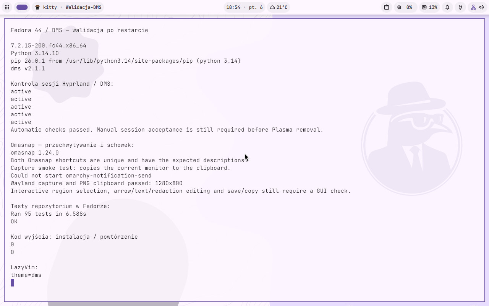
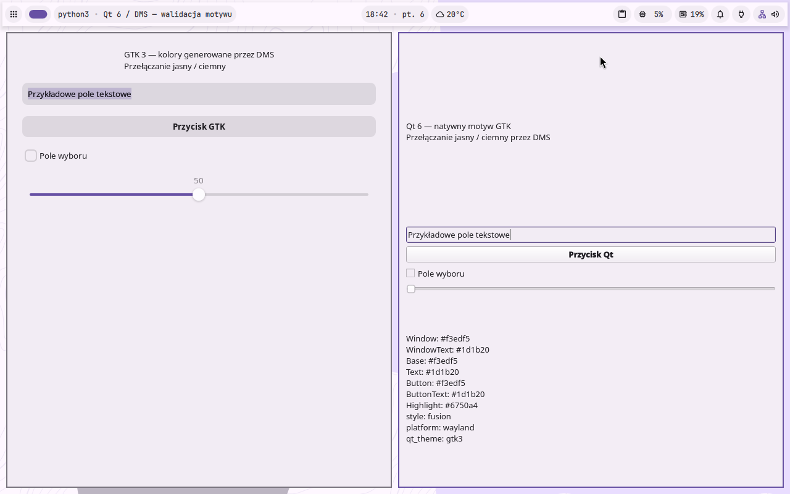
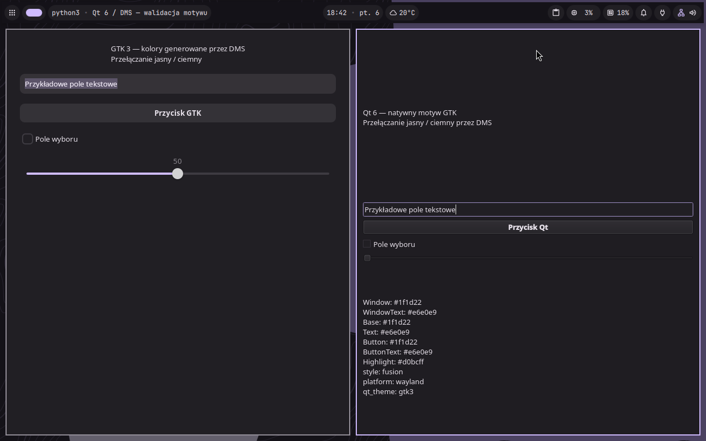
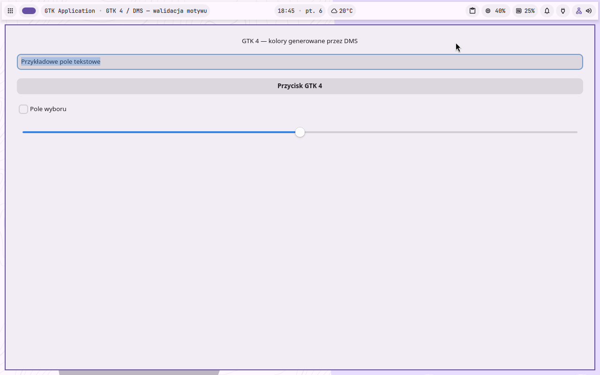
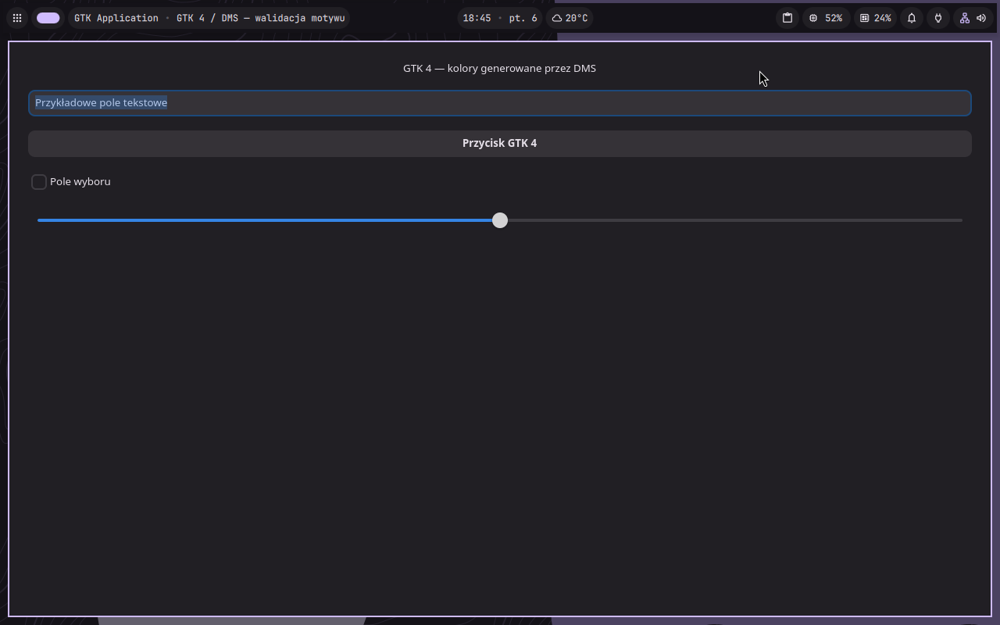
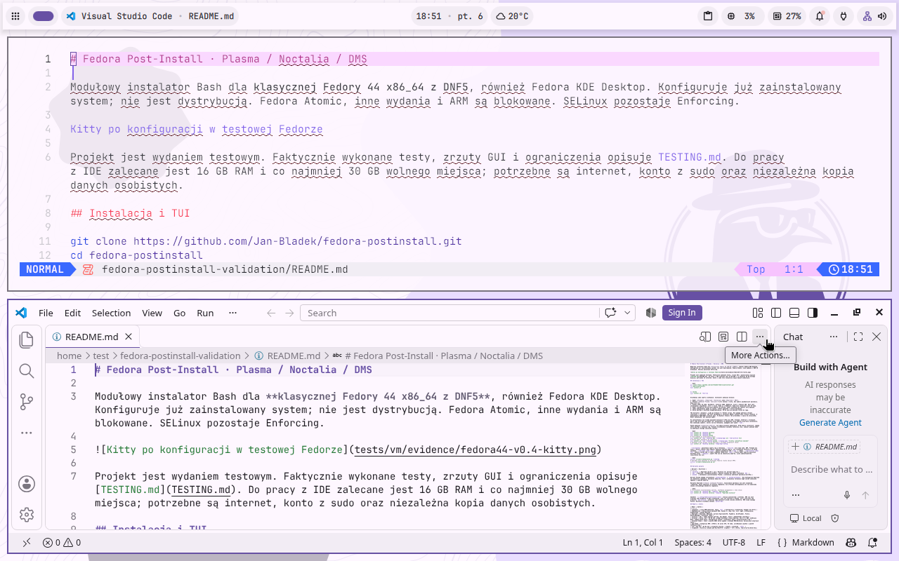
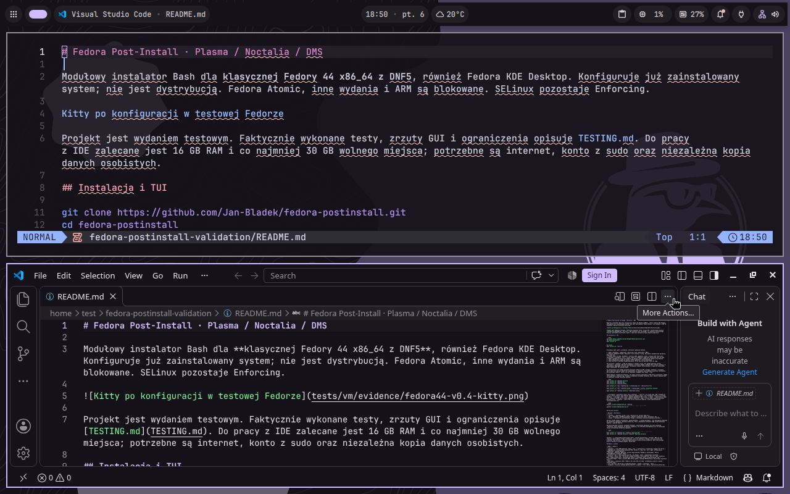
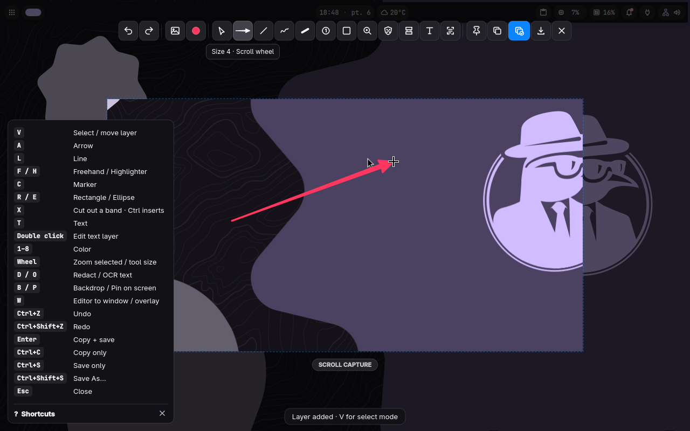
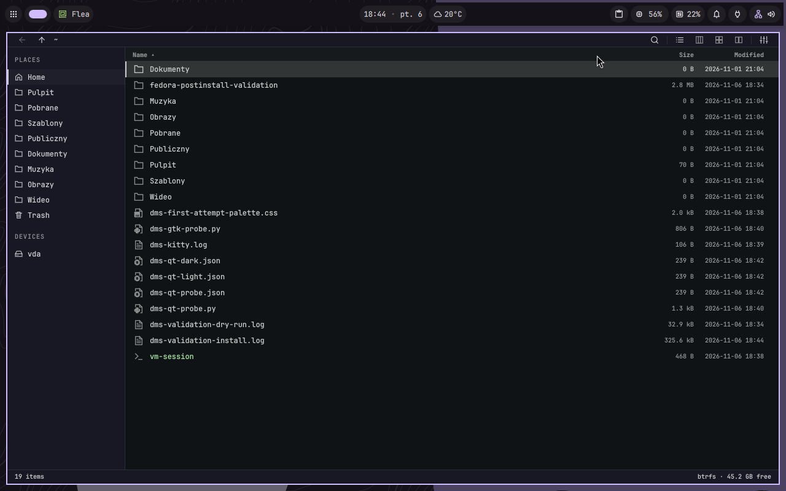

# Fedora 44 + DMS — walidacja 2026-11-06

Instalator został uruchomiony w rzeczywistej VM KVM `fedora44`, z SELinux
Enforcing, 5 vCPU i około 8 GiB RAM. Przed zmianami wykonano migawkę
`before-dms-validation-20261106`. Gość początkowo miał KDE, bez Hyprlanda, DMS,
pip, VS Code i Neovima. KDE oraz Plasma Login Manager pozostały zainstalowane.

Kod poprawek: `f1a34f16b6393f0669467ff108d105c91157e961`.
Wyniki i wersje pakietów: [result.json](result.json).

Na czas testów użyto tymczasowego klucza SSH, reguły sudo bez hasła
i autologowania do Hyprlanda. Po walidacji usunięto te ustawienia, wyłączono
SSH i normalnie wyłączono VM. Zainstalowany system i migawka sprzed testów
pozostają dostępne. Te ustawienia testowe nie są częścią instalatora.

## Instalacja i kontrole

Uruchomiono pełny domyślny zestaw DMS, z domyślnym profilem IDE `code`:

```bash
bash install.sh --desktop dms --dry-run
bash install.sh --desktop dms --yes --no-progress
```

Obejmuje to moduły `snapshots dependencies hyprland dms terminal clipboard
files hyprmod omasnap lazyvim development browsers multimedia utilities
defaults optimization updates`. `app-theme` jest wywoływany przez moduł DMS.
Następnie ponowiono cały zestaw i uruchomiono ponownie VM.

| Kontrola | Wynik |
| --- | --- |
| Pełna instalacja po poprawkach | kod 0 |
| Powtórzenie pełnej instalacji | kod 0 |
| Ponowna inicjalizacja po usunięciu obu wygenerowanych palet GTK | kod 0, pliki powstały w izolowanym katalogu |
| Zachowanie własnych ustawień DMS, VS Code, Kitty i btop | 4/4 |
| `dnf5 check`, w obu przebiegach | zaliczone |
| `tests/check.sh` w Fedorze | ShellCheck i 95/95 testów |
| Testy repozytorium na hoście | ShellCheck i 95/95 testów |
| Flea, testy upstream | 2954 zaliczone, 0 błędów, 2 ignorowane |
| Omasnap, pełny `omasnap-smoke` | 1/1, 45,62 s |
| `validate-session --check-only`, także po restarcie | zaliczone |
| `validate-omasnap --capture-smoke`, także po restarcie | PNG 1280×800 |
| Omasnap przez `Super+Shift+S`: obszar, strzałka, `Ctrl+C` | PNG 883×469, 1989 pikseli adnotacji |
| GTK 3 i Qt 6: zmiana trybu tych samych otwartych okien | jasny i ciemny działają |
| GTK 4 | powierzchnie i tekst zmieniają tryb; uwaga o akcencie poniżej |
| VS Code i LazyVim | GUI uruchomione, motywy DMS aktywne |
| Python / pip | 3.14.10 / 26.0.1 |

Do uruchomienia zestawu testów dodatkowo zainstalowano w VM `ShellCheck`
i `python3-tomlkit`; tomlkit jest potrzebny testom wariantu Noctalia.
Naprawiono także izolację testu domyślnego edytora: jego wynik nie zależy już
od obecności Flea w prawdziwym katalogu domowym osoby uruchamiającej testy.

Ustawienia sprawdzane podczas powtórzenia i po restarcie: DMS
`notepadFontSize=17`, VS Code `editor.fontSize=17`, Kitty
`scrollback_lines 12345`, btop `update_ms = 1750`.

## Błędy wykryte i poprawione

Pierwsza próba wykazała błąd inicjalizacji GTK: DMS zapisuje wyjście szablonów
według `XDG_CONFIG_HOME`, mimo przekazanego `--config-dir`. Generator otrzymuje
teraz także izolowane środowisko, więc tworzy pliki w katalogu roboczym i nie
nadpisuje istniejącej palety użytkownika.

Test wizualny wykazał pozostawienie Breeze w GSettings. Instalator wykonuje
teraz odpowiednik jawnego „Apply GTK” w DMS: zapisuje poprzednią wartość,
aktywuje adw-gtk3 i usuwa wymuszanie ciemnego wariantu przez wcześniejsze
ustawienia KDE. Obsługuje też kod 3 skryptu GTK, oznaczający brak potrzebnych
zmian przy powtórzeniu. Kontrole regresji obejmują te przypadki.

## Zrzuty z VM

PNG wykonano bezpośrednio przez `virsh screenshot` albo pobrano ze schowka
Wayland po działaniu Omasnap. Nie są to makiety. Okna GTK i Qt są natywnymi
oknami diagnostycznymi z kontrolkami; okna edytorów to uruchomione aplikacje.

### Sesja i wyniki po restarcie



### GTK 3 i Qt 6 — jasny / ciemny





Qt 6 raportował tło `#f3edf5` / `#1f1d22` oraz akcent `#6750a4` / `#d0bcff`.
Używał Waylanda i `QT_QPA_PLATFORMTHEME=gtk3`.

### GTK 4





### LazyVim i VS Code





### Omasnap: obszar i adnotacja




### Flea



## Ograniczenia

Nie wykonywano w tym przebiegu testów blokowania/odblokowania, uśpienia,
fizycznego audio ani udostępniania ekranu w OBS. Nie potwierdzono ręcznej
akceptacji wymaganej przed usunięciem Plasmy. Nie testowano interaktywnie
każdej aplikacji instalowanej przez zestaw domyślny.

GTK 4 zmienia tło i tekst, ale część kontrolek zachowuje niebieski akcent
GTK. Test natywnego okna Qt dotyczył Qt 6; dla Qt 5 sprawdzono instalację
pakietu zawierającego wtyczkę GTK, bez osobnego testu okna.

`mcelog.service` zgłasza nieobsługiwany procesor AMD udostępniony VM.
Po restarcie nie było błędnych usług użytkownika. Omasnap zgłasza brak
upstreamowego `omarchy-notification-send`; przechwytywanie, edycja oraz
schowek działają. Jego komunikat o konieczności ręcznych kontroli jest
stałym tekstem helpera; powyżej osobno udokumentowano rzeczywiście wykonaną
próbę obszaru i strzałki.

Tailscale jest zainstalowany, a `tailscaled` działa. Nie logowano VM do
tailnetu i nie potwierdzano połączenia VPN.

Flea zgłasza też jawne `SKIP` dla części zależnych od środowiska przypadków,
m.in. brak zarejestrowanego thumbnailera PNG. Liczba 2954 jest podsumowaniem
upstreamowego runnera; nie oznacza uruchomienia wszystkich opcjonalnych ścieżek.

Surowe logi są przechowywane lokalnie poza repozytorium pod
`~/.local/state/fedora-postinstall-vm/validation-20261106/`. Nie publikowano
kluczy, haseł, dysków ani prywatnych kopii konfiguracji.
