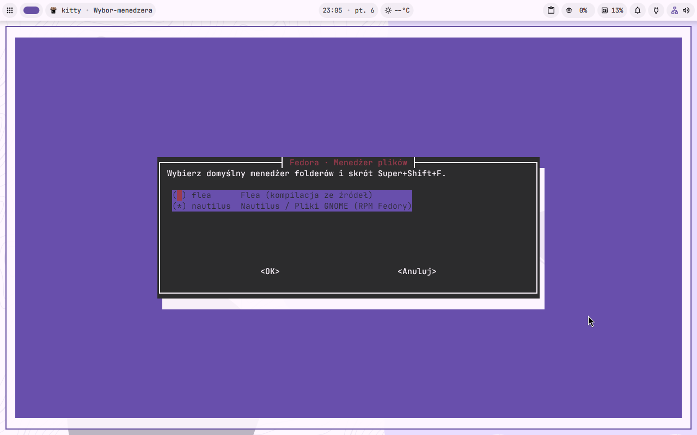
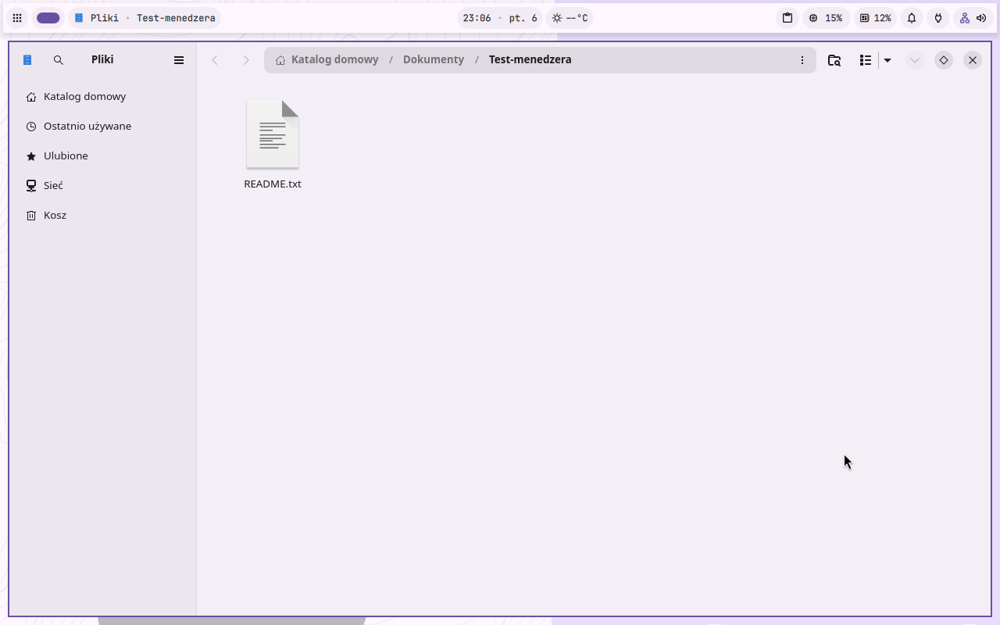
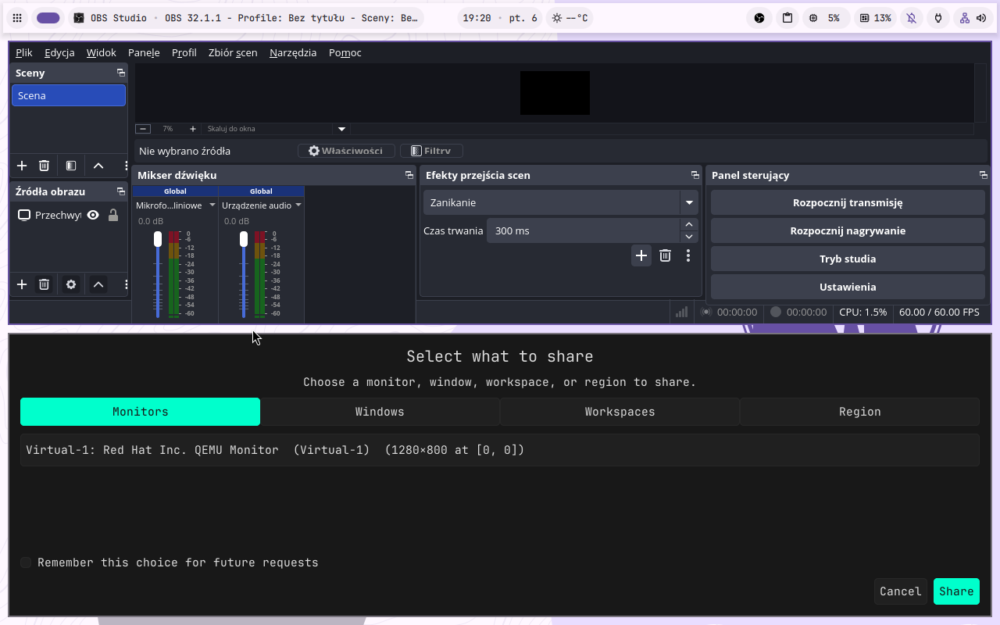
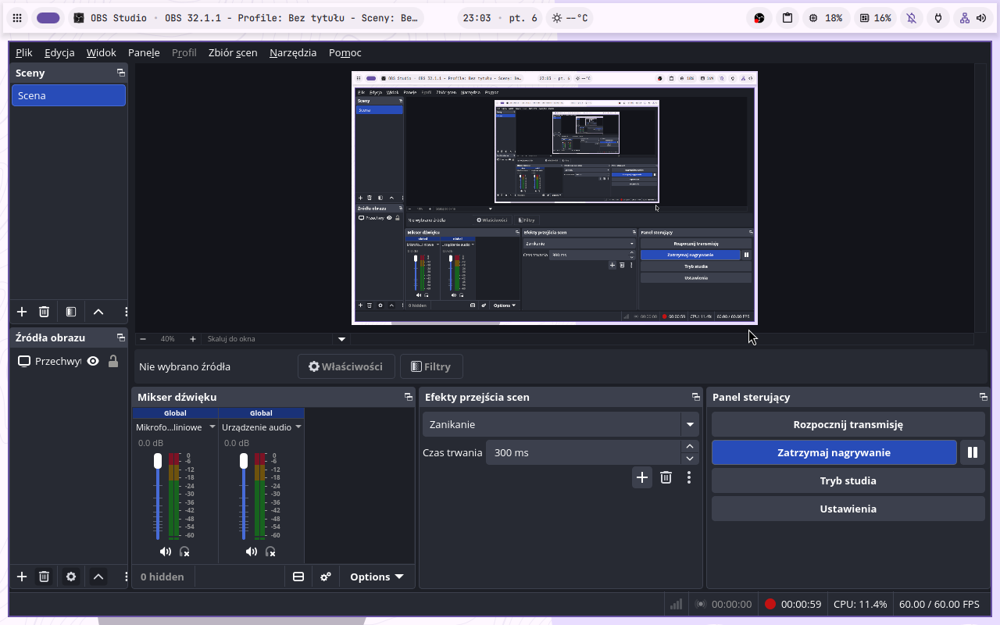
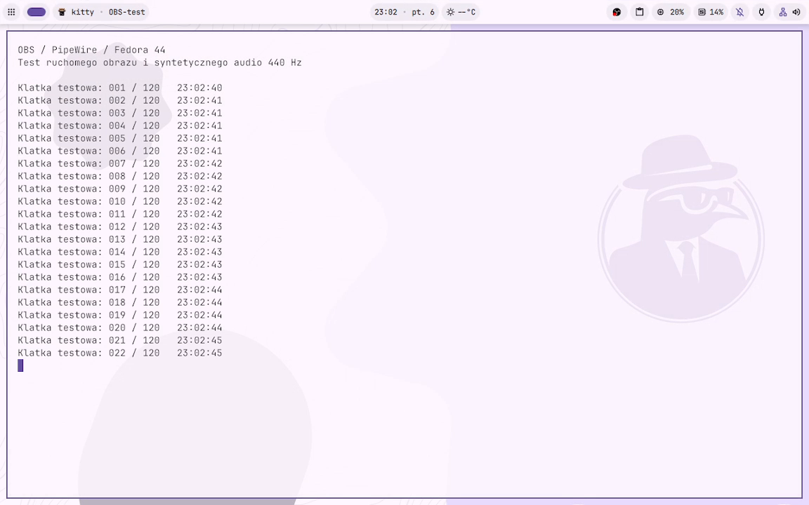

# Flea / Nautilus i OBS — testy w Fedorze 44

Kod wyboru menedżera: `70506954890f166b1ada87270d9e48950604a1f4`.
Testy wykonano w VM KVM Fedora 44 z DMS i SELinux Enforcing.
Przed testami zachowano migawkę `before-file-manager-obs-20261106`.

## Wybór menedżera plików

Dodano menu oraz `--file-manager flea|nautilus`. Wybrany menedżer obsługuje
foldery, `Super+Shift+F` i aktywację D-Bus FileManager1. Zapis wyboru znajduje
się w `~/.config/fedora-postinstall/file-manager`; jawny argument CLI ma
pierwszeństwo. Pozostawienie zainstalowanego Flea nie zmienia wyboru Nautilusa.

W VM wykonano instalację Nautilusa, powtórzenie bez podania wyboru, zmianę
na Flea i zmianę z powrotem na Nautilusa. Na finalnym kodzie ponowiono oba
warianty oraz sam moduł `defaults` bez jawnego wyboru.
Sprawdzono właściwy `inode/directory`, zapis wyboru, otwieranie folderu,
odpowiedź `FileManager1.ShowFolders` i proces `nautilus` jako właściciela tej
nazwy D-Bus. Plan debloat `all` zachował wybranego Nautilusa.

ShellCheck i **100/100 testów** przeszły na hoście oraz w Fedorze.
Testy regresji obejmują CLI, zapisany wybór, jego nadpisanie, błędne argumenty,
menu, przełączanie MIME/D-Bus, kopię wcześniejszej usługi i ochronę Nautilusa.





## OBS: wynik i ograniczenie grafiki VM

**W konfiguracji bez akceleracji 3D wybór ekranu nie przeszedł testu.**
`hyprland-share-picker` z pakietu `xdg-desktop-portal-hyprland-1.5.0-1.fc44`
dwukrotnie zakończył się SIGSEGV. OBS pozostawał uruchomiony, lecz portal
zwracał odmowę/anulowanie wyboru. Zrzuty awarii wskazują kolejno
`Hyprtoolkit::CWaylandBuffer`, `resizeSwapchain` i `configure`.
Pamięć była dostępna; nie znaleziono zdarzenia OOM.

W źródłach [Hyprtoolkit 0.6.0](https://github.com/hyprwm/hyprtoolkit/blob/v0.6.0/src/window/IWaylandWindow.cpp)
wynik alokacji swapchainu trafia bez sprawdzenia do konstruktora bufora.
Stos jest zgodny z błędem alokacji bufora; to wniosek z kodu i zrzutu,
nie pełna analiza wszystkich możliwych przyczyn w sterowniku.

Dlatego dalszy test wykonano na **odizolowanym klonie dysku z VirGL**.
Oryginalna konfiguracja VM została zachowana. Renderer OBS raportował
`Mesa virgl (NVIDIA GeForce RTX 2060/PCIe/SSE2)`, OpenGL 4.2.
W tej konfiguracji systemowy picker działał bez zastępowania go innym
programem i bez automatycznego zatwierdzania zgody na udostępnienie.
W oknie portalu wybrano monitor Virtual-1 i zatwierdzono „Share”.





Zarejestrowano zmieniający się licznik w terminalu i syntetyczny ton 440 Hz,
odtwarzany przez PipeWire i przechwytywany przez źródło audio OBS.
Nie jest to test fizycznego mikrofonu ani głośników; klon używał wirtualnego
urządzenia audio bez wyjścia na urządzenia hosta.

| Kontrola pliku nagrania | Wynik |
| --- | --- |
| Zapis i finalizacja pliku przez OBS | zaliczone |
| Czas nagrania | 70,635 s |
| Obraz | H.264 / OpenH264, 1152×720, 60 FPS |
| Odczytane klatki wideo | 4216 |
| Dźwięk | AAC, wykryty ton 440 Hz |
| Dekodowanie całego pliku z `-xerror` | bez błędów |
| Trzy próbki obrazu | niepuste, trzy różne sumy SHA256 |
| RMS dźwięku / amplituda tonu 440 Hz | 0,07886 / 0,10567 |
| Opóźnione klatki renderowania według OBS | 12 / 4246 prób, 0,3% |

Wynik walidatora: [recording-result.json](recording-result.json).
Nagranie niezależnie zdekodowano ponownie na hoście: wynik również pozytywny.
Pełny plik MP4 i surowe logi pozostają poza repozytorium w lokalnym katalogu
`~/.local/state/fedora-postinstall-vm/file-manager-obs-20261106/`.



Powtórzenie kontroli dla nagrania z ruchem i tonem 440 Hz:

```bash
python3 tests/vm/check-obs-recording.py nagranie.mp4 --output-dir /tmp/obs-check
```

Ten test potwierdza lokalne nagrywanie w konfiguracji VirGL. Nie potwierdza
streamingu do zewnętrznego serwisu, fizycznego audio ani poprawności pickera
w konfiguracji bez 3D. Awarii tej konfiguracji nie zamaskowano zmianą portalu
w instalatorze.

Tymczasowe klucze SSH, sudo bez hasła i autologowanie służyły wyłącznie
testom. Po nich usunięto te ustawienia i wyłączono gości. Dysk oryginalnej VM
oraz migawka pozostają zachowane; testowy klon i dostęp do dysku hosta
zostały uporządkowane przed wyłączeniem komputera.
